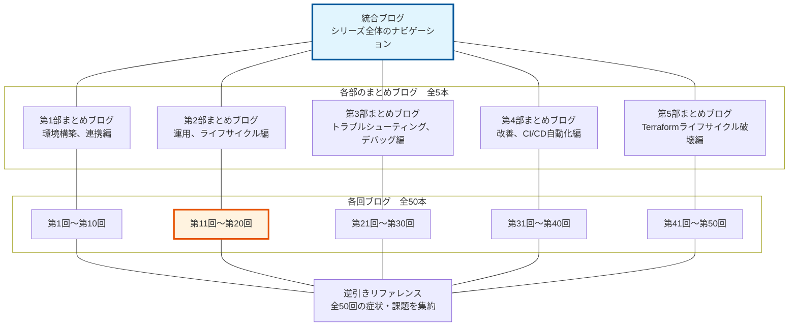

<style> table th, table td { word-break: normal; } table td:first-child { white-space: nowrap; } </style>

> **🗺️ 初めての方・シリーズの全体像を知りたい方はこちら**
> 
> シリーズ全体については、以下のまとめブログで整理しています。
> 
> → **[「AnsibleとTerraformの連携が壊れる理由はライフサイクルにあった」第2部まとめブログ： TerraformとAnsibleの運用で直面する構成ズレと状態管理の問題](https://qiita.com/juehara-crypto/items/c3e95e3bec11e07bbe75)**

---

> **🔍 今起きている症状・課題から、読むべき回を探したい方はこちら**
>
> 全50回で扱った症状・課題を、部をまたいで1か所に集めた逆引きリファレンスがあります。
> 症状・課題の一覧から原因の見当をつけ、該当する回のセクションまでたどれます。
>
> → **[「AnsibleとTerraformの連携が壊れる理由はライフサイクルにあった」逆引きリファレンス：全50回の症状・課題を5つの図から引く](https://qiita.com/juehara-crypto/items/bd2832993ef887e8022a)**

---

**※本記事の位置とシリーズ全体の関係を先に確認します。**

---

## 📍 本記事の位置



本シリーズは、**[統合ブログ](https://qiita.com/juehara-crypto/items/5bd6720b7aaed13757f8)**、第1〜5部のまとめブログ（全5本）、第1〜50回の各回ブログ（全50本）の3階層で構成されています。**現在はこの図の下段、第2部「第11回〜第20回」のうちの第13回になります。** 統合ブログとまとめブログは、シリーズを上から順に読み進めるための入口です。

また、この3階層とは別に、**[逆引きリファレンス](https://qiita.com/juehara-crypto/items/bd2832993ef887e8022a)** があります。第1〜50回の各回ブログで扱った症状・課題を、部をまたいで1か所に集め、今起きている症状や解決したい課題から、該当する回へ直接たどり着けるようにしたものです。

---

## 📋 目次

1. [はじめに](#1-はじめに)
2. [更新で済むケースと再生成になるケースの違い](#2-更新で済むケースと再生成になるケースの違い)
3. [terraform planの出力による事前判定](#3-terraform-planの出力による事前判定)
4. [再生成時のAnsible設定消失パターン](#4-再生成時のansible設定消失パターン)
5. [再生成リスクを考慮したコード修正の設計方針](#5-再生成リスクを考慮したコード修正の設計方針)
6. [まとめ](#6-まとめ)
7. [次回予告](#7-次回予告)
8. [連載一覧：「AnsibleとTerraformの連携が壊れる理由はライフサイクルにあった」](#8-連載一覧ansibleとterraformの連携が壊れる理由はライフサイクルにあった)

---

## 1. はじめに

「設定を1行書き換えて`terraform apply`を実行しただけなのに、コンテナが作り直されてAnsibleの設定が消えた」という経験はないでしょうか。

前回、**[第12回](https://juehara-crypto.github.io/blog/infra/ansible/ansible-terraform/ansible-terraform-part2/ansible-terraform-part2-12/)** では、初期化スクリプト・コンテナ起動定義の変更を起点に、Terraformがリソースを破棄、再生成し、Ansibleが投入したOS内部の設定が消失する連鎖構造を確認しました。その過程で、破棄、再生成の対象になる属性は、初期化スクリプトに相当するものだけに限らないことにも触れました。

今回扱うのは、この「初期化スクリプトに限らない」という部分をもう一段具体化する内容です。Terraformはリソース属性の変更に対して、常に同じ扱いをするわけではありません。ある属性の変更は「更新」として、リソースを壊さずにその場で反映されます。別の属性の変更は「破棄、再生成」として、リソースを一度壊してから作り直すという形で反映されます。この違いは、コードを書いている側からは見えにくく、`terraform apply`を実行して初めて結果として現れることが少なくありません。

具体的には、次のような場面です。

- 再起動ポリシー（`restart`）の1行を書き換えたら`terraform plan`は`~`（更新）だった
- ポートマッピング（`ports`）の1行を書き換えたら`terraform plan`は`-/+`（破棄、再生成）だった
- 同じ「1行の変更」でも、属性によって結果が違う

この違いがどこから来るのか、そして`apply`を実行する前にこの違いをどう見分けるのかが、今回のテーマです。

この回では、「どのHCL定義変更が更新で済み、どの変更が破棄、再生成になるのか」という判定構造を軸に、内容を整理します。まず次のセクションで、この判定構造そのものの前提となる、更新と破棄、再生成という2つの処理の違いを確認します。

---

[↑ 目次に戻る](#-目次)

---

## 2. 更新で済むケースと再生成になるケースの違い

この回の前提となる、「更新」と「破棄、再生成」という2つの処理の違いを整理します。

Terraformはリソース属性の変更を検知した際、常に同じ方法でその変更を反映するわけではありません。反映の方法は、大きく分けて次の2種類です。

* **更新（in-place update）**：リソースを破棄せず、変更のあった属性だけをその場で書き換える。リソースそのものは存続するため、Ansibleが投入したOS内部の設定は保持される
* **破棄、再生成（replace）**：リソースを一度破棄し、新しい属性値で作り直す。リソースそのものが入れ替わるため、Ansibleが投入したOS内部の設定は消失する

**[第12回](https://juehara-crypto.github.io/blog/infra/ansible/ansible-terraform/ansible-terraform-part2/ansible-terraform-part2-12/)** で確認した`upload`ブロックの変更は、この2つのうち後者、破棄、再生成にあたるケースでした。

どちらの扱いになるかは、変更する属性の種類によって決まります。より正確に言うと、この判定はTerraform本体ではなく、**リソースプロバイダーの実装**によって決まります。プロバイダーが、ある属性について「稼働中のリソースに対してその場で書き換える手段」を実装していれば、その属性の変更は更新として反映されます。逆に、プロバイダー側にその手段が実装されていない、あるいはリソースの性質上その場での書き換えが不可能な属性については、プロバイダーはその変更を「更新不可」として扱い、破棄、再生成という形でしか反映できません。

`docker_container`リソース（`kreuzwerker/docker`プロバイダー v3.0.2）を例に、この2つの分かれ方を具体的に見ておきます。

再生成になる属性変更の例として、以下が挙げられます。

* ポートマッピング（`ports`）の変更
* 環境変数（`env`）の追加
* ラベル（`labels`）の追加

`ports`は、セクション3とセクション4で詳しく扱います。環境変数やラベルについては、次の検証で、実際に`terraform plan`の表示を確認します。

### ■ 検証内容（環境変数とラベルの追加が、更新ではなく再生成になることの確認）

以下は検証用の別ディレクトリ（`docker-lab-verify13`、`kreuzwerker/docker` v3.0.2）で取得したログです。このディレクトリは、コンテナ1台に`/etc/init_marker`の`upload`ブロックだけを入れた最小構成です（SSH公開鍵の`upload`は入れていません）。`restart`を入れる前の状態に、`labels`と`env`をそれぞれ1つずつ追加して、`terraform plan`を実行しました。

まず、`labels`を追加します。

* **ファイル名：**`main.tf`

```hcl
  labels {
    label = "managed_by"
    value = "terraform"
  }
```

`upload`ブロックの後ろ、`lifecycle`ブロックの前に追加しました。

**実行コマンド**

```plaintext
terraform plan
```

**▼ 実行結果**

```plaintext
  # docker_container.node1 must be replaced
-/+ resource "docker_container" "node1" {
      + bridge                                      = (known after apply)
      ~ command                                     = [
          - "/usr/sbin/sshd",
          - "-D",
        ] -> (known after apply)
      + container_logs                              = (known after apply)
      - cpu_shares                                  = 0 -> null
      - dns                                         = [] -> null
      - dns_opts                                    = [] -> null
      - dns_search                                  = [] -> null
      ~ entrypoint                                  = [] -> (known after apply)
      ~ env                                         = [] -> (known after apply)
      + exit_code                                   = (known after apply)
      - group_add                                   = [] -> null
      ~ hostname                                    = "c7178e119bbb" -> (known after apply)
      ~ id                                          = "c7178e119bbb7963c6ace5f147d2468461f5e317a083367e02171d653b776769" -> (known after apply)
      ~ init                                        = false -> (known after apply)
      ~ ipc_mode                                    = "private" -> (known after apply)
      ~ log_driver                                  = "json-file" -> (known after apply)
      - log_opts                                    = {} -> null
      - max_retry_count                             = 0 -> null
      - memory                                      = 0 -> null
      - memory_swap                                 = 0 -> null
        name                                        = "verify13-node1"
      ~ network_data                                = [
          - {
              - gateway                   = "172.18.0.1"
              - global_ipv6_prefix_length = 0
              - ip_address                = "172.18.0.2"
              - ip_prefix_length          = 16
              - mac_address               = "fa:e7:f8:29:aa:9c"
              - network_name              = "verify13-net"
                # (2 unchanged attributes hidden)
            },
        ] -> (known after apply)
      - network_mode                                = "bridge" -> null
      - privileged                                  = false -> null
      - publish_all_ports                           = false -> null
      ~ runtime                                     = "runc" -> (known after apply)
      ~ security_opts                               = [] -> (known after apply)
      ~ shm_size                                    = 64 -> (known after apply)
      + stop_signal                                 = (known after apply)
      ~ stop_timeout                                = 0 -> (known after apply)
      - storage_opts                                = {} -> null
      - sysctls                                     = {} -> null
      - tmpfs                                       = {} -> null
        # (20 unchanged attributes hidden)

      ~ healthcheck (known after apply)

      + labels { # forces replacement
          + label = "managed_by"
          + value = "terraform"
        }

        # (3 unchanged blocks hidden)
    }

Plan: 1 to add, 0 to change, 1 to destroy.
```

`+ labels { # forces replacement`と表示され、リソースは`-/+`、`Plan: 1 to add, 0 to change, 1 to destroy`です。ラベルを1つ追加しただけで、更新ではなく破棄、再生成として扱われます。

続けて、追加した`labels`を外して元の状態に戻したうえで、`env`を追加します。

* **ファイル名：**`main.tf`

```hcl
  env = ["APP_ENV=production"]
```

`upload`ブロックの後ろ、`lifecycle`ブロックの前に追加しました。

**実行コマンド**

```plaintext
terraform plan
```

**▼ 実行結果**

```plaintext
  # docker_container.node1 must be replaced
-/+ resource "docker_container" "node1" {
      + bridge                                      = (known after apply)
      ~ command                                     = [
          - "/usr/sbin/sshd",
          - "-D",
        ] -> (known after apply)
      + container_logs                              = (known after apply)
      - cpu_shares                                  = 0 -> null
      - dns                                         = [] -> null
      - dns_opts                                    = [] -> null
      - dns_search                                  = [] -> null
      ~ entrypoint                                  = [] -> (known after apply)
      ~ env                                         = [ # forces replacement
          + "APP_ENV=production",
        ]
      + exit_code                                   = (known after apply)
      - group_add                                   = [] -> null
      ~ hostname                                    = "c7178e119bbb" -> (known after apply)
      ~ id                                          = "c7178e119bbb7963c6ace5f147d2468461f5e317a083367e02171d653b776769" -> (known after apply)
      ~ init                                        = false -> (known after apply)
      ~ ipc_mode                                    = "private" -> (known after apply)
      ~ log_driver                                  = "json-file" -> (known after apply)
      - log_opts                                    = {} -> null
      - max_retry_count                             = 0 -> null
      - memory                                      = 0 -> null
      - memory_swap                                 = 0 -> null
        name                                        = "verify13-node1"
      ~ network_data                                = [
          - {
              - gateway                   = "172.18.0.1"
              - global_ipv6_prefix_length = 0
              - ip_address                = "172.18.0.2"
              - ip_prefix_length          = 16
              - mac_address               = "fa:e7:f8:29:aa:9c"
              - network_name              = "verify13-net"
                # (2 unchanged attributes hidden)
            },
        ] -> (known after apply)
      - network_mode                                = "bridge" -> null
      - privileged                                  = false -> null
      - publish_all_ports                           = false -> null
      ~ runtime                                     = "runc" -> (known after apply)
      ~ security_opts                               = [] -> (known after apply)
      ~ shm_size                                    = 64 -> (known after apply)
      + stop_signal                                 = (known after apply)
      ~ stop_timeout                                = 0 -> (known after apply)
      - storage_opts                                = {} -> null
      - sysctls                                     = {} -> null
      - tmpfs                                       = {} -> null
        # (20 unchanged attributes hidden)

      ~ healthcheck (known after apply)

      ~ labels (known after apply)

        # (3 unchanged blocks hidden)
    }

Plan: 1 to add, 0 to change, 1 to destroy.
```

`~ env = [ # forces replacement`と表示され、リソースは`-/+`、`Plan: 1 to add, 0 to change, 1 to destroy`です。環境変数を1つ追加しただけで、更新ではなく破棄、再生成として扱われます。

### ■ 結果

`labels`の追加、`env`の追加は、どちらも`terraform plan`で`-/+`と`# forces replacement`が表示されました。環境変数やラベルのように、一見すると稼働中のコンテナに後から付け足せそうな設定であっても、このプロバイダーでは破棄、再生成として扱われます。属性の見た目や、設定内容の軽さから、更新で済むかどうかを推測することはできません。

一方、更新で済む属性変更の例として、以下が挙げられます。

* 再起動ポリシー（`restart`）の変更

`restart`を`"no"`から`"always"`に変更した場合、`terraform plan`の出力は`~`（update in-place）となり、`Plan: 0 to add, 1 to change, 0 to destroy`と表示されました。この変更を`apply`した後も、コンテナ内部に置いたファイルは保持されていました。更新で済む属性の変更であれば、コンテナは存続し、内部の設定にも影響は及びません。この`restart`の`terraform plan`と`apply`のログは、セクション3とセクション4で示します。

ここで注意しておきたいのは、どの属性が更新で済み、どの属性が破棄、再生成になるかという組み合わせは、プロバイダーとリソースごとに異なるという点です。上の例は`kreuzwerker/docker`プロバイダーでの実測であり、他のプロバイダーにそのまま当てはまるとは限りません。ただし、「属性ごとに更新可否があらかじめ決まっており、それに応じてTerraformの扱いが分かれる」という構造そのものは、プロバイダーを問わず共通しています。

この構造を踏まえると、コードを修正する側にとって重要なのは、個々の属性が更新可能かどうかを暗記することではなく、**変更を加える前に、その変更が更新になるのか破棄、再生成になるのかを確認する手段を持っておくこと**です。次のセクションでは、この確認を`apply`実行前に行うための、`terraform plan`の出力の読み方を整理します。

---

[↑ 目次に戻る](#-目次)

---

## 3. terraform planの出力による事前判定

前セクションで確認した通り、リソース属性の変更が更新になるか破棄、再生成になるかは、プロバイダーの実装によってあらかじめ決まっています。この判定は、コードを書いている時点では見えません。しかし、`terraform apply`を実行する前であれば、`terraform plan`の出力からこの判定結果を確認できます。

`terraform plan`の出力には、変更の種類を示す記号が含まれます。

```plaintext
~   : 更新（リソースは破棄されない）
-/+ : 破棄、再生成（リソースが破棄されAnsibleの設定が消失する）
```

この記号の意味を、実機で確認します。

### ■ 検証内容（ポートマッピングの変更が`terraform plan`で`-/+`として表示されることの確認）

検証には、`docker_container.targets`の`ports`ブロックを使用します。`external`の値は`locals`ブロックの`target_nodes`マップで定義されており、`target-node1`の値のみを変更します。

* **ファイル名：**`main.tf`

```hcl
locals {
  target_nodes = {
    "target-node1" = 2231
    "target-node2" = 2222
    "target-node3" = 2223
  }
}
```

`target-node1`の値のみを`2221`から`2231`に変更し、`target-node2`、`target-node3`には変更を加えていません。

**実行コマンド**

```plaintext
terraform plan
```

**▼ 実行結果**

```plaintext
  # docker_container.targets["target-node1"] must be replaced
-/+ resource "docker_container" "targets" {
      + bridge                                      = (known after apply)
      ~ command                                     = [
          - "/usr/sbin/sshd",
          - "-D",
        ] -> (known after apply)
      + container_logs                              = (known after apply)
      - cpu_shares                                  = 0 -> null
      - dns                                         = [] -> null
      - dns_opts                                    = [] -> null
      - dns_search                                  = [] -> null
      ~ entrypoint                                  = [] -> (known after apply)
      ~ env                                         = [] -> (known after apply)
      + exit_code                                   = (known after apply)
      - group_add                                   = [] -> null
      ~ hostname                                    = "c207933bacf2" -> (known after apply)
      ~ id                                          = "c207933bacf2af6824303c3d9f99155398618f4f89b6c3444ed0fd5436eacac6" -> (known after apply)
      ~ init                                        = false -> (known after apply)
      ~ ipc_mode                                    = "private" -> (known after apply)
      ~ log_driver                                  = "json-file" -> (known after apply)
      - log_opts                                    = {} -> null
      - max_retry_count                             = 0 -> null
      - memory                                      = 0 -> null
      - memory_swap                                 = 0 -> null
        name                                        = "target-node1"
      ~ network_data                                = [
          - {
              - gateway                   = "172.20.0.1"
              - global_ipv6_prefix_length = 0
              - ip_address                = "172.20.0.4"
              - ip_prefix_length          = 24
              - mac_address               = "f6:a6:93:bf:4b:73"
              - network_name              = "ansible-lab-net"
                # (2 unchanged attributes hidden)
            },
        ] -> (known after apply)
      - network_mode                                = "bridge" -> null
      - privileged                                  = false -> null
      - publish_all_ports                           = false -> null
      ~ runtime                                     = "runc" -> (known after apply)
      ~ security_opts                               = [] -> (known after apply)
      ~ shm_size                                    = 64 -> (known after apply)
      + stop_signal                                 = (known after apply)
      ~ stop_timeout                                = 0 -> (known after apply)
      - storage_opts                                = {} -> null
      - sysctls                                     = {} -> null
      - tmpfs                                       = {} -> null
        # (20 unchanged attributes hidden)

      ~ healthcheck (known after apply)

      ~ labels (known after apply)

      ~ ports {
          ~ external = 2221 -> 2231 # forces replacement
            # (3 unchanged attributes hidden)
        }

        # (3 unchanged blocks hidden)
    }

  # local_file.ansible_inventory must be replaced
-/+ resource "local_file" "ansible_inventory" {
      ~ content              = <<-EOT
            [target_nodes]
            target-node1 ansible_host=172.20.0.4 ansible_user=ansible
            target-node2 ansible_host=172.20.0.3 ansible_user=ansible
            target-node3 ansible_host=172.20.0.2 ansible_user=ansible
        EOT -> (known after apply) # forces replacement
        # (中略：content_base64sha256等のハッシュ値差分)
    }

Plan: 2 to add, 0 to change, 2 to destroy.

Changes to Outputs:
  ~ target_nodes_ips = {
      ~ target-node1 = "172.20.0.4" -> (known after apply)
        # (2 unchanged attributes hidden)
    }
```

出力の先頭には`# docker_container.targets["target-node1"] must be replaced`とあり、リソース全体の記号も`-/+`です。変更を加えたのは`target-node2`、`target-node3`ではなく`target-node1`のみであるため、`-/+`が付いているのも`target-node1`だけであり、他の2台には一切差分が出ていません。

再生成の根拠は、出力の中でピンポイントに示されています。

```plaintext
~ ports {
    ~ external = 2221 -> 2231 # forces replacement
      # (3 unchanged attributes hidden)
  }
```

`external`の値の変更行に`# forces replacement`という注記が付いており、この属性の変更が破棄、再生成を引き起こすことが明示されています。

一方、同じ出力の中には`- network_mode = "bridge" -> null`という表示もありますが、こちらには`forces replacement`の注記はありません。これは`lifecycle.ignore_changes`の対象にしている属性です。**[第12回](https://juehara-crypto.github.io/blog/infra/ansible/ansible-terraform/ansible-terraform-part2/ansible-terraform-part2-12/)** の`upload`ブロック変更時と同じ構造で、再生成の引き金になった属性とそうでない属性が、出力上明確に区別されています。

なお、`docker_container.targets`に連動する形で`local_file.ansible_inventory`も`must be replaced`となっています。`target-node1`のIPアドレスが再生成によって変わる可能性があるため、インベントリファイルの内容もあわせて再生成対象になっています。

`Plan: 2 to add, 0 to change, 2 to destroy`という表示も、更新（`0 to change`）ではなく、追加と破棄という組み合わせでこの変更が扱われることを裏付けています。

比較のため、更新で済む属性の`terraform plan`も示します。以下は検証用の別ディレクトリ（`docker-lab-verify13`、`kreuzwerker/docker` v3.0.2）で取得したログで、`docker_container`の`restart`を`"no"`から`"always"`に変更した場合のものです。この別ディレクトリは、コンテナ1台に`/etc/init_marker`の`upload`ブロックだけを入れた最小構成です（SSH公開鍵の`upload`は入れていません）。

**▼ 実行結果**

```plaintext
（…Refreshing state...の行は省略…）

Terraform will perform the following actions:

  # docker_container.node1 will be updated in-place
  ~ resource "docker_container" "node1" {
        id                                          = "c7178e119bbb7963c6ace5f147d2468461f5e317a083367e02171d653b776769"
        name                                        = "verify13-node1"
      ~ restart                                     = "no" -> "always"
        # (48 unchanged attributes hidden)

        # (3 unchanged blocks hidden)
    }

Plan: 0 to add, 1 to change, 0 to destroy.
```

`# docker_container.node1 will be updated in-place`と表示され、記号は`~`、`0 to destroy`です。`# forces replacement`の注記はなく、この変更ではコンテナは破棄されません。`ports`の変更で見た`-/+`と`must be replaced`の表示とは、出力の形がはっきり異なります。

### ■ 結果

この検証から、`terraform plan`の出力にある`-/+`という記号と`# forces replacement`という注記が、破棄、再生成の発生を`apply`前に予告する役割を果たしていることが確認できました。一方、`restart`の変更では`~`と`0 to destroy`が表示され、同じ`docker_container`でも属性によって更新で済むか再生成になるかが分かれることも、`apply`前の`plan`から読み取れます。`external`という1つの属性の変更が、コンテナ全体、さらには関連する`local_file`リソースにまで再生成を波及させる様子が、`apply`を実行する前の時点で読み取れます。

この`-/+`が表示されている場合、`apply`を実行すればリソースが破棄されることが事前に分かります。次のセクションでは、この破棄が実際に発生した後、Ansibleが投入した設定に何が起きるかを、引き続き実機で確認します。

---

[↑ 目次に戻る](#-目次)

---

## 4. 再生成時のAnsible設定消失パターン

前セクションでは、`terraform plan`の出力から、破棄、再生成が発生することを`apply`前に確認できることを見ました。このセクションでは、実際に`apply`を実行し、破棄、再生成が発生した後、Ansibleが投入した設定に何が起きるかを確認します。

### ■ 検証内容（ポートマッピングの変更による再生成が、Ansible管理下のファイルと初期化処理管理下のファイルにそれぞれどう影響するかの確認）

前セクションの`terraform plan`を実行した状態から、`terraform apply`を実行します。

**実行コマンド**

```
terraform apply
```

`yes`で承認すると、target-node1のみが破棄、再生成されました。

**▼ 実行結果**

```
Do you want to perform these actions?
  Terraform will perform the actions described above.
  Only 'yes' will be accepted to approve.

  Enter a value: yes

local_file.ansible_inventory: Destroying... [id=733afaba17b50383acf6b02a681a2bf4379feed0]
local_file.ansible_inventory: Destruction complete after 0s
docker_container.targets["target-node1"]: Destroying... [id=c207933bacf2af6824303c3d9f99155398618f4f89b6c3444ed0fd5436eacac6]
docker_container.targets["target-node1"]: Destruction complete after 2s
docker_container.targets["target-node1"]: Creating...
docker_container.targets["target-node1"]: Creation complete after 1s [id=39cd5018935f622b17c7e704867a703fda6650c806403e54e4f3c27c84f9d616]
local_file.ansible_inventory: Creating...
local_file.ansible_inventory: Creation complete after 0s [id=733afaba17b50383acf6b02a681a2bf4379feed0]

Apply complete! Resources: 2 added, 0 changed, 2 destroyed.

Outputs:

target_nodes_ips = {
  "target-node1" = "172.20.0.4"
  "target-node2" = "172.20.0.3"
  "target-node3" = "172.20.0.2"
}
```

target-node1のみが新しいコンテナとして再生成されました。前セクションで`target-node1`のみに変更を加えたため、`target-node2`、`target-node3`はログにも一切登場していません。

IPアドレスに注目すると、`target-node1`は再生成後も`172.20.0.4`のままで変わっていません。**[第12回](https://juehara-crypto.github.io/blog/infra/ansible/ansible-terraform/ansible-terraform-part2/ansible-terraform-part2-12/)** では3台同時に再生成した結果、解放されたIPアドレスが別のノードに割り当てられる形で入れ替わりが発生していましたが、今回は1台のみの再生成で、再生成前と同じ`172.20.0.4`が割り当てられました。同じIPアドレスになる場合も、入れ替わる場合もあり、再生成後のIPアドレスが元と一致する保証はありません。

再生成されたtarget-node1で、Ansible管理下の`/etc/app.conf`と、初期化処理管理下の`/etc/init_marker`をそれぞれ確認します。

**実行コマンド**

```
docker exec -it target-node1 cat /etc/app.conf
```

**▼ 実行結果**

```
cat: /etc/app.conf: No such file or directory
```

Ansibleが投入したはずの`/etc/app.conf`が存在しなくなっています。

**実行コマンド**

```
docker exec -it target-node1 cat /etc/init_marker
```

**▼ 実行結果**

```
init_version=v1
```

一方、初期化処理が書き込む`/etc/init_marker`は、再生成時に`upload`ブロックで改めて書き込まれるため、再生成後のコンテナにも存在しています。

### ■ 結果

この検証から、ポートマッピングという、初期化スクリプトとは無関係の属性変更であっても、破棄、再生成が発生すれば、**[第12回](https://juehara-crypto.github.io/blog/infra/ansible/ansible-terraform/ansible-terraform-part2/ansible-terraform-part2-12/)** で確認したのと同じ構造で、Ansibleが投入した設定が消失することが確認できました。消える対象がAnsible管理下の`/etc/app.conf`であり、初期化処理管理下の`/etc/init_marker`は再生成時に改めて書き込まれるという対比も、前回と同じです。

ここで整理しておきたいのは、Ansibleの設定が消えるかどうかを決めているのは、変更した属性が「初期化スクリプトに関係するかどうか」ではなく、**その属性変更が`terraform plan`で`# forces replacement`と表示される変更かどうか**という点です。今回変更したのはコンテナの起動定義や初期化処理とは無関係の`ports`ブロックでしたが、Dockerプロバイダーの実装ではこの属性が「更新不可」とされているため、破棄、再生成という扱いになり、結果としてAnsibleの設定も同じように消失しました。

リソースの内部にあるものは、破棄、再生成が発生した時点ですべて失われます。この消失は、初期化スクリプトの変更が引き金であっても、今回のようにポートマッピングの変更が引き金であっても、結果としては同じです。Ansibleを再実行しない限り、この状態は自動では復旧しません。

### ■ 検証内容（更新で済む属性の変更では、コンテナ内部のファイルが保持されることの確認）

対比として、更新で済む属性の変更では、この消失は起きないことも確認しました。前セクションで`~`と表示された`restart`の変更を、検証用の別ディレクトリ（`docker-lab-verify13`、`kreuzwerker/docker` v3.0.2）で確認しました。

`apply`の前に、コンテナ内部に目印のファイルを手で置きました。

**実行コマンド**

```plaintext
docker exec verify13-node1 bash -c "echo 'placed_by=manual' > /etc/app.conf"
docker exec verify13-node1 cat /etc/app.conf
```

**▼ 実行結果**

```plaintext
placed_by=manual
```

この状態で、`restart`の変更を`apply`しました。

**実行コマンド**

```plaintext
terraform apply
```

**▼ 実行結果**

```plaintext
（…Refreshing state...の行は省略…）

Terraform will perform the following actions:

  # docker_container.node1 will be updated in-place
  ~ resource "docker_container" "node1" {
        id                                          = "c7178e119bbb7963c6ace5f147d2468461f5e317a083367e02171d653b776769"
        name                                        = "verify13-node1"
      ~ restart                                     = "no" -> "always"
        # (48 unchanged attributes hidden)

        # (3 unchanged blocks hidden)
    }

Plan: 0 to add, 1 to change, 0 to destroy.

Do you want to perform these actions?
  Terraform will perform the actions described above.
  Only 'yes' will be accepted to approve.

  Enter a value: yes

docker_container.node1: Modifying... [id=c7178e119bbb7963c6ace5f147d2468461f5e317a083367e02171d653b776769]
docker_container.node1: Modifications complete after 0s [id=c7178e119bbb7963c6ace5f147d2468461f5e317a083367e02171d653b776769]

Apply complete! Resources: 0 added, 1 changed, 0 destroyed.
```

`apply`は`Apply complete! Resources: 0 added, 1 changed, 0 destroyed.`で完了し、コンテナのIDも前後で変わっていません。続けて、コンテナ内部に手で置いたファイル（`/etc/app.conf`）と`/etc/init_marker`の状態を確認しました。

**実行コマンド**

```plaintext
docker exec verify13-node1 cat /etc/app.conf
docker exec verify13-node1 cat /etc/init_marker
```

**▼ 実行結果**

```plaintext
placed_by=manual
init_version=v1
```

### ■ 結果

内部のファイルは両方とも保持されていました。この`/etc/app.conf`は、Ansibleではなく手で置いたファイルです。Ansibleが投入した設定も、コンテナが破棄されない限り、同じようにコンテナ内部に残ります。

---

[↑ 目次に戻る](#-目次)

---

## 5. 再生成リスクを考慮したコード修正の設計方針

セクション2〜4で整理した内容を振り返ります。セクション3、4の実機検証では、Docker環境における`ports`属性の変更を具体例として取り上げましたが、「更新になるか破棄、再生成になるか」という判定そのものは、セクション2で整理した通りプロバイダーの実装によって決まる話であり、Docker特有の構造ではありません。AWS・GCPなど別のプロバイダーであっても、リソースごとにどの属性が更新可能でどの属性が更新不可（`terraform plan`で`# forces replacement`と表示される）なのかという同じ問いが存在します。したがって、ここから整理する設計方針も、Docker環境に限らず、コード修正を行うあらゆるプロバイダー環境に共通する内容として位置づけます。

### 変更前にterraform planで再生成の有無を確認する

コード修正を行った後は、`apply`を実行する前に必ず`terraform plan`を実行し、`-/+`の有無を確認する習慣を持つことが基本になります。セクション3で確認した通り、`-/+`が表示されているリソースには`# forces replacement`という注記が該当の属性変更行に付与されており、どの属性が再生成の引き金になっているかを`apply`前に読み取ることができます。この確認を省略し、`plan`の出力を見ないまま`apply`を実行すると、意図しないリソースの破棄、再生成に気づく機会を失います。

### 再生成が発生する場合はAnsibleの再実行をセットで計画する

`-/+`が確認された場合、その`apply`によってAnsibleが投入した設定が消失することは、セクション4で確認した通りです。この消失を前提とし、`apply`の実行とAnsibleの再実行を、1つの作業としてセットで計画しておく必要があります。

```
terraform planで「-/+」を確認する
　↓
terraform applyを実行する（リソースが再生成される）
　↓
ansible-playbookを再実行する（OS設定が復元される）
```

セクション4の検証では、この一連の流れのうち`apply`実行後の状態（`/etc/app.conf`が消失した状態）までを確認しました。この状態から`ansible-playbook`を再実行すれば、`/etc/app.conf`は再びdesired stateへ復帰します。重要なのは、この再実行が自動では行われないという点です。`apply`を実行した担当者が、この消失を認識し、Ansibleの再実行まで手順に含めておかない限り、OS設定が空白のまま運用が続くことになります。

### データの永続化が必要な場合は外部ストレージへの分離を検討する

リソース内部に保存されたデータは、セクション4で確認した通り、リソースの破棄、再生成の影響を直接受けます。Ansibleが再実行によって復元できるのは、Playbookが管理している設定やファイルに限られます。リソース内部でしか存在しないデータ、例えばアプリケーションが実行時に生成するデータなどは、Ansibleの再実行によって復元することはできません。

こうしたデータについては、リソース内部に置かず、外部ストレージへ分離するという設計が根本的な対応になります。この分離の実装をどう設計するかは、ステートフルなデータ（VolumeやDB）を保持したまま安全に再構築する方法を扱う **[第47回](https://juehara-crypto.github.io/blog/infra/ansible/ansible-terraform/ansible-terraform-part5/ansible-terraform-part5-47/)** の内容であり、この回ではこれ以上踏み込みません。

以上の3点は、いずれも「破棄、再生成はいつか起こり得るものである」という前提に立った備え方です。属性変更が破棄、再生成として扱われる仕組みそのものを、コード修正でなくすことはできません。修正前の確認、修正後の運用手順、データ設計という3つの観点で備えておくことが、この回で整理した消失リスクへの現実的な対応になります。

---

[↑ 目次に戻る](#-目次)

---

## 6. まとめ

この回で整理した内容を確認します。

* TerraformのHCL定義変更が「更新」になるか「破棄、再生成」になるかは、リソースプロバイダーの実装によって決まる。稼働中のリソースに対してその場で反映できる属性は更新、反映できない属性は破棄、再生成として扱われる
* `terraform plan`の出力にある`~`は更新、`-/+`は破棄、再生成を意味する。`-/+`が表示されているリソースには、再生成の根拠となる属性変更行に`# forces replacement`という注記が付与されており、`apply`前にこの記号と注記を確認することで、再生成の発生を事前に把握できる
* 破棄、再生成が発生した時点で、リソース内部にあったAnsibleが投入したファイル、パッケージ、サービス設定、データはすべて消失する。今回はDocker環境のポートマッピングの変更を具体例として確認したが、この消失は初期化スクリプトに関係する属性変更に限らず、`terraform plan`で`# forces replacement`と表示される属性変更であれば同じ構造で発生する
* コード修正前に`terraform plan`で再生成の有無を確認し、`-/+`が出た場合は`apply`とAnsibleの再実行をセットで計画する。リソース内部にしか存在しないデータについては、外部ストレージへの分離が根本的な対応になる

---

[↑ 目次に戻る](#-目次)

---

## 7. 次回予告

**[第12回](https://juehara-crypto.github.io/blog/infra/ansible/ansible-terraform/ansible-terraform-part2/ansible-terraform-part2-12/)** では、`terraform apply`という正規の操作そのものが、初期化スクリプト・コンテナ起動定義の変更を起点にAnsibleの設定を消失させる連鎖構造を整理しました。今回はその視点をさらに踏み込み、TerraformのHCL定義変更が「更新」で済むケースと「破棄、再生成」になるケースを分ける判定構造そのものを扱いました。`terraform plan`の出力にある`~`と`-/+`という記号、そして`# forces replacement`という注記が、この判定結果を`apply`前に示していること、Docker環境のポートマッピングの変更を具体例に、破棄、再生成が発生した際にAnsibleが投入した設定が消失する様子を確認しました。

次回は、この消失を復旧する側であるAnsible Playbookに焦点を移します。今回整理した通り、再生成が発生した後はAnsibleの再実行によってOS設定を復元する運用が前提になりますが、この再実行そのものが安全に行えるかどうかは、Playbookの冪等性設計にかかっています。`local-exec`経由で再実行されたAnsibleが、冪等でない`command`（`mkdir`）の「File exists」で失敗すると、`terraform apply`自体が止まり、この復旧作業自体が新たなトラブルの原因になります。

**[次回：第14回：local-execで再実行されたAnsibleが失敗し、terraform applyが止まる理由](https://juehara-crypto.github.io/blog/infra/ansible/ansible-terraform/ansible-terraform-part2/ansible-terraform-part2-14/)**

---

📑 連載の移動　**[前の記事：【Ansible×Terraform編】第12回](https://juehara-crypto.github.io/blog/infra/ansible/ansible-terraform/ansible-terraform-part2/ansible-terraform-part2-12/)　｜　[次の記事：【Ansible×Terraform編】第14回](https://juehara-crypto.github.io/blog/infra/ansible/ansible-terraform/ansible-terraform-part2/ansible-terraform-part2-14/)**

---

> **🗺️ 初めての方・シリーズの全体像を知りたい方はこちら**
> 
> シリーズ全体については、以下のまとめブログで整理しています。
> 
> → **[「AnsibleとTerraformの連携が壊れる理由はライフサイクルにあった」第2部まとめブログ： TerraformとAnsibleの運用で直面する構成ズレと状態管理の問題](https://qiita.com/juehara-crypto/items/c3e95e3bec11e07bbe75)**

---

> **🔍 今起きている症状・課題から、読むべき回を探したい方はこちら**
>
> 全50回で扱った症状・課題を、部をまたいで1か所に集めた逆引きリファレンスがあります。
> 症状・課題の一覧から原因の見当をつけ、該当する回のセクションまでたどれます。
>
> → **[「AnsibleとTerraformの連携が壊れる理由はライフサイクルにあった」逆引きリファレンス：全50回の症状・課題を5つの図から引く](https://qiita.com/juehara-crypto/items/bd2832993ef887e8022a)**

---


[↑ 目次に戻る](#-目次)

---

## 8. 連載一覧：「AnsibleとTerraformの連携が壊れる理由はライフサイクルにあった」

### 第2部：運用、ライフサイクル編

|回数|テーマ、記事タイトル|概要|
|---|---|---|
|**[第11回](https://juehara-crypto.github.io/blog/infra/ansible/ansible-terraform/ansible-terraform-part2/ansible-terraform-part2-11/)**|Terraformのplanが、手動やAnsibleによるOS内部の変更を検知できない理由―tfstateの管理範囲と、--check --diffによる補完|構築後に手動やAnsibleで変更したOS内部の状態は、tfstateの管理範囲の外にあるため、Terraformの`plan`では検知できない。Ansibleの`--check --diff`による補完と、インフラ層、OS層を二軸で確認、同期する手順を整理する。ドリフトシリーズとの接続を示す。|
|**[第12回](https://juehara-crypto.github.io/blog/infra/ansible/ansible-terraform/ansible-terraform-part2/ansible-terraform-part2-12/)**|初期化スクリプト・コンテナ起動定義を変更してterraform applyを再実行すると、コンテナが作り直されてAnsibleの設定が消える理由―uploadブロックのforces replacementと、初期化処理とAnsibleの役割分離|初期化スクリプトやコンテナ起動定義の変更で`forces replacement`が発生し、リソースが破棄、再生成されて、Ansibleが設定済みのOS内部状態が消える課題。初期化処理とAnsibleの役割分離で消失の影響を小さくする設計を整理する。|
|**[第13回](https://juehara-crypto.github.io/blog/infra/ansible/ansible-terraform/ansible-terraform-part2/ansible-terraform-part2-13/)**|HCLの1行の変更でコンテナが破棄、再生成され、Ansibleの設定が消える理由―更新と再生成の分かれ目と、terraform planの「-/+」「forces replacement」による事前判定|HCLの1行の変更でも、属性によっては「更新」ではなく「破棄、再生成」となり、Ansibleが投入した設定が消える。`terraform plan`の`~`と`-/+`、`forces replacement`の注記から、`apply`前に再生成を見分ける方法を整理する。|
|**[第14回](https://juehara-crypto.github.io/blog/infra/ansible/ansible-terraform/ansible-terraform-part2/ansible-terraform-part2-14/)**|local-execで再実行されたAnsibleが失敗し、terraform applyが止まる理由―冪等でないcommand（mkdir）と、--check --diffでは検出できない限界|`local-exec`経由でAnsibleが複数回実行される構成で、冪等でないPlaybookが2回目の実行で失敗し、`terraform apply`自体の失敗につながる問題。専用モジュールへの置き換えと、`--check --diff`では検出できない限界を整理する。冪等性シリーズ、レガシーPlaybook引き継ぎの知識を実践に適用する回として位置づける。|
|**[第15回](https://juehara-crypto.github.io/blog/infra/ansible/ansible-terraform/ansible-terraform-part2/ansible-terraform-part2-15/)**|複数人が別々のディレクトリでterraform applyしたtfstateを上書きすると記録が消え、出力名の変更だけでAnsibleのスクリプトも止まる理由―state lockingの守備範囲と、中間ファイルによる分離|複数人が別々のディレクトリで扱ったtfstateを上書きすると記録が消える問題と、Ansible担当がtfstateを直接参照すると、出力名の変更だけでスクリプトが止まる問題。state lockingの守備範囲と、中間ファイルによる分離、apply実行権限の設計を整理する。|
|**[第16回](https://juehara-crypto.github.io/blog/infra/ansible/ansible-terraform/ansible-terraform-part2/ansible-terraform-part2-16/)**|apt update／apt upgradeでパッケージが更新されると、バージョンを前提にしたAnsible Playbookが失敗する理由―Terraformのイメージ固定の範囲外と、aptモジュールでのバージョン指定|運用中に`apt update`、`apt upgrade`でパッケージが更新されると、バージョンを前提にしたAnsible Playbookが失敗する問題。Terraformのイメージ固定が及ばない範囲と、`apt`モジュールでのバージョン指定による制御を整理する。|
|**[第17回](https://juehara-crypto.github.io/blog/infra/ansible/ansible-terraform/ansible-terraform-part2/ansible-terraform-part2-17/)**|リソースの再生成でIPアドレスが変わると、静的インベントリのままではAnsibleがUNREACHABLEになる理由―動的インベントリで追従できる範囲と、DNS・hostsなど追従できない参照|リソースの再生成でIPアドレスが変わると、書き換えていない静的インベントリではAnsibleが`UNREACHABLE`になる問題。動的インベントリで追従できる範囲と、DNSや`/etc/hosts`など追従できない参照を整理する。|
|**[第18回](https://juehara-crypto.github.io/blog/infra/ansible/ansible-terraform/ansible-terraform-part2/ansible-terraform-part2-18/)**|sensitive = trueを指定してもtfstateにパスワードが平文で残る理由―Ansible Vaultとの責務分担と、Vaultの誤用パターン|`sensitive = true`を指定しても、`output`の値がtfstateに平文で残る問題。TerraformとAnsible Vaultの責務分担と、Vaultの誤用パターンと回避策を整理する。|
|**[第19回](https://juehara-crypto.github.io/blog/infra/ansible/ansible-terraform/ansible-terraform-part2/ansible-terraform-part2-19/)**|ベースイメージをUbuntu 22.04から24.04に切り替えると、ansible_python_interpreterでPython 3.10を固定したPlaybookがnot foundで失敗する理由―自動検出との違いと、/etc/apt/sources.listの形式変更|ベースイメージをUbuntu 22.04から24.04に切り替えると、`ansible_python_interpreter`をパスで固定したPlaybookが`not found`で失敗する問題。自動検出との違いと、`/etc/apt/sources.list`の形式変更、標準モジュールの抽象化の限界を整理する。|
|**[第20回](https://juehara-crypto.github.io/blog/infra/ansible/ansible-terraform/ansible-terraform-part2/ansible-terraform-part2-20/)**|運用編まとめ：第11〜19回のトラブルは、リソースを直し続ける運用と作り直す運用のどちらで起きるか―ステートフルならミュータブル、ステートレスならイミュータブルという使い分け|第11〜19回のトラブルを、リソースを直し続けるミュータブル運用と、作り直すイミュータブル運用の軸で整理する。ステートフルならミュータブル、ステートレスならイミュータブルという使い分けを着地点として示す。|

---

[↑ 目次に戻る](#-目次)

---