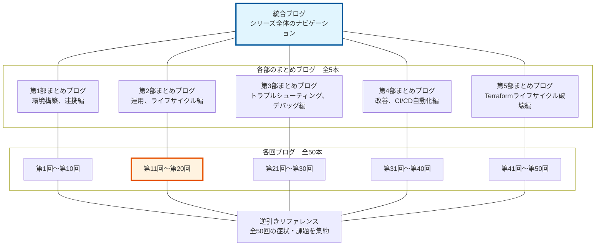

<style> table th, table td { word-break: normal; } table td:first-child { white-space: nowrap; } </style>

> **🗺️ 初めての方・シリーズの全体像を知りたい方はこちら**
> 
> シリーズ全体については、以下のまとめブログで整理しています。
> 
> → **[「AnsibleとTerraformの連携が壊れる理由はライフサイクルにあった」第2部まとめブログ： TerraformとAnsibleの運用で直面する構成ズレと状態管理の問題](https://qiita.com/juehara-crypto/items/c3e95e3bec11e07bbe75)**

---

> **🔍 今起きている症状・課題から、読むべき回を探したい方はこちら**
>
> 全50回で扱った症状・課題を、部をまたいで1か所に集めた逆引きリファレンスがあります。
> 症状・課題の一覧から原因の見当をつけ、該当する回のセクションまでたどれます。
>
> → **[「AnsibleとTerraformの連携が壊れる理由はライフサイクルにあった」逆引きリファレンス：全50回の症状・課題を5つの図から引く](https://qiita.com/juehara-crypto/items/bd2832993ef887e8022a)**

---

**※本記事の位置とシリーズ全体の関係を先に確認します。**

---

## 📍 本記事の位置



本シリーズは、**[統合ブログ](https://qiita.com/juehara-crypto/items/5bd6720b7aaed13757f8)**、第1〜5部のまとめブログ（全5本）、第1〜50回の各回ブログ（全50本）の3階層で構成されています。**現在はこの図の下段、第2部「第11回〜第20回」のうちの第16回になります。** 統合ブログとまとめブログは、シリーズを上から順に読み進めるための入口です。

また、この3階層とは別に、**[逆引きリファレンス](https://qiita.com/juehara-crypto/items/bd2832993ef887e8022a)** があります。第1〜50回の各回ブログで扱った症状・課題を、部をまたいで1か所に集め、今起きている症状や解決したい課題から、該当する回へ直接たどり着けるようにしたものです。

---

## 📋 目次

1. [はじめに](#1-はじめに)
2. [Terraformのイメージ定義とOS内部状態の分離](#2-terraformのイメージ定義とos内部状態の分離)
3. [apt updateによるバージョン変化がAnsibleに与える影響](#3-apt-updateによるバージョン変化がansibleに与える影響)
4. [ミドルウェアのメジャーバージョンアップによる設定ファイル形式の変化](#4-ミドルウェアのメジャーバージョンアップによる設定ファイル形式の変化)
5. [更新を「禁止」せず「制御」する設計](#5-更新を禁止せず制御する設計)
6. [Terraform側のイメージピン留め](#6-terraform側のイメージピン留め)
7. [Ansible側のパッケージバージョン固定](#7-ansible側のパッケージバージョン固定)
8. [バージョンアップを許容する場合の検証フロー](#8-バージョンアップを許容する場合の検証フロー)
9. [まとめ](#9-まとめ)
10. [次回予告](#10-次回予告)
11. [連載一覧：「AnsibleとTerraformの連携が壊れる理由はライフサイクルにあった」](#11-連載一覧ansibleとterraformの連携が壊れる理由はライフサイクルにあった)

---

## 1. はじめに

「最初は問題なく動いていたはずの構成が、運用を続けるうちに突然エラーを起こすようになった」という経験はないでしょうか。

**[第15回](https://juehara-crypto.github.io/blog/infra/ansible/ansible-terraform/ansible-terraform-part2/ansible-terraform-part2-15/)** では、複数人が別々のディレクトリで扱ったtfstateを上書きすると記録が消えること、Ansible担当がtfstateを直接参照すると、出力名の変更だけでスクリプトが止まることを確認しました。この問題の発生源は、複数人がtfstateを扱うことにありました。

今回扱うのは、これとは性質の異なる問題です。TerraformのコードもAnsibleのPlaybookも変えていないのに、リソースの起動後にOS内部のパッケージが更新されていくことで、Playbookが前提としていた状態との間に矛盾が生じるケースを扱います。

具体的には、次のような場面です。

* コンテナやVMの内部で`apt update`、`apt upgrade`を実行し、OSのパッケージを最新化した
* セキュリティパッチの適用として、日常的な運用の一環で行っただけのつもりだった
* ところが、その後にAnsible Playbookを実行すると、以前は成功していたはずのタスクが失敗するようになった

この事象の背景には、Terraformが固定的に管理しているものと、そうでないものの境界があります。Terraformはリソースを起動する際の元になるイメージを指定しますが、そのイメージから起動した後、OS内部でパッケージがどう更新されていくかまでは管理していません。`apt update`はセキュリティ上必要な操作であり、これ自体を禁止することは現実的ではありません。しかし、この更新によってOS内部のパッケージバージョンがTerraformの定義から独立して進行していくと、Ansible Playbookが前提としていたバージョンや設定ファイル形式との間に、いずれ矛盾が生じます。

この回では、この「時間経過によるバージョン変化」がなぜ起きるのかを構造から整理したうえで、Terraform側で何を固定し、Ansible側で何を固定するかという、両者を組み合わせた制御の設計を見ていきます。

まず次のセクションで、この回全体の前提となる、Terraformのイメージ定義とOS内部状態がどのように分離しているかを整理します。

---

[↑ 目次に戻る](#-目次)

---

## 2. Terraformのイメージ定義とOS内部状態の分離

この回全体の前提となる構造を整理します。

Terraformは、コンテナやVMといったリソースを生成する際、その起動元となるイメージを指定します。今回の検証環境で言えば、`docker_image`リソースが参照する`Dockerfile`がこれにあたります。Terraformが管理しているのは、このイメージの指定そのものであり、指定した時点でのイメージの内容は、ビルドが行われた時点のパッケージバージョンで固定されています。

しかし、このイメージから起動したコンテナやVMの内部では、運用が始まった後も状態が変化し続けます。`apt update`・`apt upgrade`といった操作でOS内部のパッケージを更新すれば、そのバージョンはTerraformが指定したイメージのビルド時点から離れ、独立して進行していきます。

```plaintext
Terraformが管理する範囲：起動元イメージの指定（ビルド時点でパッケージバージョンが固定される）
　　↓
　　リソースの起動
　　↓
Terraformの管理範囲外：OS内部でのパッケージ更新（運用中に、イメージの定義とは独立して進行する）
```

ここで押さえておきたいのは、「Terraformでイメージを固定しているから、環境は安定している」という考え方が、正確ではないという点です。Terraformが固定しているのは、あくまでリソースが最初に起動する瞬間の状態です。起動した後にOS内部で何が起きるかは、Terraformの差分検知の対象に含まれていません。

この構造は、これまでの回で確認してきた内容とも重なります。検証環境の`docker_image`リソースは、`Dockerfile`の中身が変更されても、`dockerfile`属性（ファイル名）自体に変更がない限り、その変更を自動的には検知しません。`terraform plan`が「No changes」と判定していても、それはあくまでTerraformが比較対象としている属性に差分がないことを意味するのであって、イメージの中身やOS内部の状態が変化していないことを意味するわけではないという点は、これまでの回で繰り返し確認してきた構造と同じです。

今回のテーマである`apt update`によるパッケージバージョンの変化は、この「Terraformの管理範囲外」で進行する変化の一例にあたります。次のセクションでは、この変化が実際にAnsible Playbookの実行にどのような影響を与えるかを、実機で確認します。

---

[↑ 目次に戻る](#-目次)

---

## 3. apt updateによるバージョン変化がAnsibleに与える影響

パッケージバージョンの変化が、Ansible Playbookの実行にどう影響するかを実機で確認します。

検証には、特定バージョンのパッケージを前提にしたPlaybookを使用します。`curl`のバージョンを`package_facts`で取得し、想定したバージョンと一致するかどうかを`assert`で確認する、というシンプルな構成です。

* **ファイル名：**`playbooks/check_curl_version.yml`
```yaml
---
- name: curlのバージョンが前提と一致するか確認する（バージョン変化検知デモ）
  hosts: target-node1
  become: true
  gather_facts: false
  tasks:
    - name: パッケージ情報を取得する
      ansible.builtin.package_facts:
        manager: apt

    - name: curlのバージョンが想定通りであることを確認する
      ansible.builtin.assert:
        that:
          - ansible_facts.packages['curl'][0].version == "7.81.0-1ubuntu1.25"
        fail_msg: "curlのバージョンが想定と異なります。現在のバージョン: {{ ansible_facts.packages['curl'][0].version }}"
        success_msg: "curlのバージョンは想定通りです（{{ ansible_facts.packages['curl'][0].version }}）"
```

target-node1のみを対象とし、target-node2、target-node3には変更を加えません。

### ■ 検証内容（curlのバージョンを前提にしたPlaybookが、apt updateによるバージョン変化後にどう振る舞うかの確認）

まず、Playbookを実行し、正常に完了することを確認します。

**実行コマンド**

```plaintext
ansible-playbook -i ~/iac/docker-lab/inventory.ini ~/iac/ansible/playbooks/check_curl_version.yml
```

**▼ 実行結果**

```plaintext
PLAY [curlのバージョンが前提と一致するか確認する（バージョン変化検知デモ）] *****************************************************************************************************************
TASK [パッケージ情報を取得する] *************************************************************************************************************************************************************
[WARNING]: Platform linux on host target-node1 is using the discovered Python interpreter at /usr/bin/python3.10, but future installation of another Python interpreter could change the
meaning of that path. See https://docs.ansible.com/ansible-core/2.17/reference_appendices/interpreter_discovery.html for more information.
ok: [target-node1]
TASK [curlのバージョンが想定通りであることを確認する] ***************************************************************************************************************************************
ok: [target-node1] => {
    "changed": false,
    "msg": "curlのバージョンは想定通りです（7.81.0-1ubuntu1.25）"
}
PLAY RECAP **********************************************************************************************************************************************************************************
target-node1               : ok=2    changed=0    unreachable=0    failed=0    skipped=0    rescued=0    ignored=0
```

`assert`が成功し、`curlのバージョンは想定通りです（7.81.0-1ubuntu1.25）`という`success_msg`が表示されました。この時点を起点として、target-node1のみで`apt update`、`apt upgrade`を実行します。

**実行コマンド**

```plaintext
ansible target-node1 -i ~/iac/docker-lab/inventory.ini -m shell -a "apt-get update && apt-get upgrade -y" --become
```

**▼ 実行結果**

```plaintext
target-node1 | CHANGED | rc=0 >>
Hit:1 http://security.ubuntu.com/ubuntu jammy-security InRelease
Hit:2 http://archive.ubuntu.com/ubuntu jammy InRelease
Hit:3 http://archive.ubuntu.com/ubuntu jammy-updates InRelease
Hit:4 http://archive.ubuntu.com/ubuntu jammy-backports InRelease
Reading package lists...
Reading package lists...
Building dependency tree...
Reading state information...
Calculating upgrade...
The following packages will be upgraded:
  curl libcurl4 libnss-systemd libpam-systemd libsystemd0 libudev1 systemd
  systemd-sysv systemd-timesyncd wget
10 upgraded, 0 newly installed, 0 to remove and 0 not upgraded.
Need to get 6181 kB of archives.
After this operation, 12.3 kB of additional disk space will be used.
Get:1 http://archive.ubuntu.com/ubuntu jammy-updates/main amd64 libnss-systemd amd64 249.11-0ubuntu3.22 [133 kB]
Get:2 http://security.ubuntu.com/ubuntu jammy-security/main amd64 wget amd64 1.21.2-2ubuntu1.5 [339 kB]
Get:3 http://archive.ubuntu.com/ubuntu jammy-updates/main amd64 systemd-timesyncd amd64 249.11-0ubuntu3.22 [31.2 kB]
Get:4 http://archive.ubuntu.com/ubuntu jammy-updates/main amd64 systemd-sysv amd64 249.11-0ubuntu3.22 [10.5 kB]
Get:5 http://archive.ubuntu.com/ubuntu jammy-updates/main amd64 libpam-systemd amd64 249.11-0ubuntu3.22 [203 kB]
Get:6 http://archive.ubuntu.com/ubuntu jammy-updates/main amd64 systemd amd64 249.11-0ubuntu3.22 [4587 kB]
Get:7 http://archive.ubuntu.com/ubuntu jammy-updates/main amd64 libsystemd0 amd64 249.11-0ubuntu3.22 [316 kB]
Get:8 http://archive.ubuntu.com/ubuntu jammy-updates/main amd64 libudev1 amd64 249.11-0ubuntu3.22 [75.9 kB]
Get:9 http://archive.ubuntu.com/ubuntu jammy-updates/main amd64 curl amd64 7.81.0-1ubuntu1.26 [194 kB]
Get:10 http://archive.ubuntu.com/ubuntu jammy-updates/main amd64 libcurl4 amd64 7.81.0-1ubuntu1.26 [292 kB]
Fetched 6181 kB in 2s (3784 kB/s)
（…途中省略、各パッケージの展開・設定ログ…）
Setting up wget (1.21.2-2ubuntu1.5) ...
Setting up systemd (249.11-0ubuntu3.22) ...
Setting up systemd-timesyncd (249.11-0ubuntu3.22) ...
Setting up libcurl4:amd64 (7.81.0-1ubuntu1.26) ...
Setting up curl (7.81.0-1ubuntu1.26) ...
Setting up systemd-sysv (249.11-0ubuntu3.22) ...
Setting up libnss-systemd:amd64 (249.11-0ubuntu3.22) ...
Setting up libpam-systemd:amd64 (249.11-0ubuntu3.22) ...
debconf: unable to initialize frontend: Dialog
debconf: (No usable dialog-like program is installed, so the dialog based frontend cannot be used. at /usr/share/perl5/Debconf/FrontEnd/Dialog.pm line 78.)
debconf: falling back to frontend: Readline
debconf: unable to initialize frontend: Readline
debconf: (Can't locate Term/ReadLine.pm in @INC (you may need to install the Term::ReadLine module) (@INC contains: /etc/perl /usr/local/lib/x86_64-linux-gnu/perl/5.34.0 /usr/local/share/perl/5.34.0 /usr/lib/x86_64-linux-gnu/perl5/5.34 /usr/share/perl5 /usr/lib/x86_64-linux-gnu/perl-base /usr/lib/x86_64-linux-gnu/perl/5.34 /usr/share/perl/5.34 /usr/local/lib/site_perl) at /usr/share/perl5/Debconf/FrontEnd/Readline.pm line 7.)
debconf: falling back to frontend: Teletype
Processing triggers for dbus (1.12.20-2ubuntu4.1) ...
Processing triggers for libc-bin (2.35-0ubuntu3.14) ...debconf: delaying package configuration, since apt-utils is not installed
```

`curl`を含む10個のパッケージが更新され、`curl`は`7.81.0-1ubuntu1.25`から`7.81.0-1ubuntu1.26`に上がりました。`debconf`関連の警告は、対話的な設定フロントエンドがコンテナ環境に存在しないために表示されるものであり、パッケージの更新自体には影響していません。

この状態で、同じPlaybookを再実行します。

**実行コマンド**

```plaintext
ansible-playbook -i ~/iac/docker-lab/inventory.ini ~/iac/ansible/playbooks/check_curl_version.yml
```

**▼ 実行結果**

```plaintext
PLAY [curlのバージョンが前提と一致するか確認する（バージョン変化検知デモ）] *****************************************************************************************************************
TASK [パッケージ情報を取得する] *************************************************************************************************************************************************************
[WARNING]: Platform linux on host target-node1 is using the discovered Python interpreter at /usr/bin/python3.10, but future installation of another Python interpreter could change the
meaning of that path. See https://docs.ansible.com/ansible-core/2.17/reference_appendices/interpreter_discovery.html for more information.
ok: [target-node1]
TASK [curlのバージョンが想定通りであることを確認する] ***************************************************************************************************************************************
fatal: [target-node1]: FAILED! => {
    "assertion": "ansible_facts.packages['curl'][0].version == \"7.81.0-1ubuntu1.25\"",
    "changed": false,
    "evaluated_to": false,
    "msg": "curlのバージョンが想定と異なります。現在のバージョン: 7.81.0-1ubuntu1.26"
}
PLAY RECAP **********************************************************************************************************************************************************************************
target-node1               : ok=1    changed=0    unreachable=0    failed=1    skipped=0    rescued=0    ignored=0
```

1回目は`ok`で完了していたPlaybookが、`apt update`、`apt upgrade`を挟んだ2回目の実行では`fatal`となり、`assert`タスクが失敗しました。エラーメッセージには、Playbookが前提としていたバージョン（`7.81.0-1ubuntu1.25`）と、実際に取得された現在のバージョン（`7.81.0-1ubuntu1.26`）の食い違いが明示されています。

### ■ 結果

この検証から、`apt update`、`apt upgrade`によるパッケージバージョンの変化が、Ansible Playbookの実行結果に直接影響することが確認できました。1回目の実行時点では正しかった前提（`curl`のバージョン）が、運用中の何気ないアップデート操作によって崩れ、同じPlaybookが2回目には失敗するという構造です。

今回はバージョン文字列の完全一致を`assert`で検証するという、意図的にシンプルな構成を使いましたが、実務でこれと同じ構造の問題が起きる場面はより広く存在します。特定バージョンのパッケージが生成する設定ファイルの形式を前提にしたテンプレート、特定バージョン以降でしか使えないコマンドオプションを使うタスクなど、「あるバージョンを前提にした処理」であれば、同じようにアップデート後に矛盾が生じ得ます。

ここで重要なのは、この矛盾が発生する条件です。今回のtarget-node1に対する変更は、TerraformのHCLコードを一切変更せずに発生しました。**[セクション2](#2-terraformのイメージ定義とos内部状態の分離)** で整理した通り、Terraformが管理しているのはリソースの起動元イメージまでであり、起動後にOS内部で行われる`apt update`はその管理範囲の外側で進行します。今回のPlaybookの失敗は、まさにこの管理範囲外で起きた変化が、Ansible側の前提を崩した結果です。

次のセクションでは、この変化の中でも特に影響が大きいケース、ミドルウェアのメジャーバージョンアップによる設定ファイル形式の変化を整理します。

---

[↑ 目次に戻る](#-目次)

---


## 4. ミドルウェアのメジャーバージョンアップによる設定ファイル形式の変化

セクション3で確認したパッケージバージョンの変化の中でも、特に影響が大きいケースを整理します。

セクション3で扱った`curl`のようなコマンドラインツールは、バージョンが上がってもコマンドの基本的な使い方自体はほとんど変わりません。しかし、ミドルウェア（Webサーバー、データベース、メッセージキュー等）がメジャーバージョンアップを行う場合、設定ファイルの構文そのものが変更されることがあります。

```plaintext
旧バージョン：設定ファイルの記述形式A
　↓ メジャーバージョンアップ
新バージョン：設定ファイルの記述形式B（旧形式は非互換）
```

Ansibleの`template`モジュールで設定ファイルを生成する構成を取っている場合、この変化は次のような形で表面化します。

```plaintext
Ansibleのtemplateが生成する設定ファイル：記述形式Aのまま（テンプレート側は更新されていない）
　↓
apt update／apt upgradeによりミドルウェアが新バージョンへ上がる
　↓
新バージョンのミドルウェアは記述形式Aを解釈できない、または一部の設定項目を無視する
　↓
ミドルウェアが起動しない、あるいは意図した設定が反映されないまま起動する
```

ここで押さえておきたいのは、この現象が起きる原因は、セクション3で確認した構造とまったく同じだという点です。Terraformが固定しているのは起動元イメージであり、そこから起動した後にミドルウェアがどのバージョンへ上がっていくかは、Terraformの管理範囲外で進行します。Ansible側の`template`は、Playbookを実行した時点でのミドルウェアのバージョンを前提に書かれていますが、その前提はパッケージの更新によって静かに崩れていきます。

セクション3との違いは、崩れ方の性質にあります。セクション3の`assert`のように、バージョンの不一致が明示的なエラーとして検知できるケースばかりではありません。設定ファイルの構文変更は、次のようなパターンで表面化します。

* 新バージョンが起動時に設定ファイルをパースできず、エラーで起動に失敗する
* 新バージョンが未知の設定項目を無視し、エラーは出ないまま意図した設定が反映されない
* 設定項目の意味そのものが変わっており、エラーは出ないが動作が意図と異なる

特に2つ目、3つ目のパターンは、Ansibleの実行自体は`changed`や`ok`のまま完了してしまうため、Playbookの実行結果だけを見ていては気づけません。セクション3で扱った「Playbookが失敗して気づく」ケースよりも、発見が遅れやすいという点で、運用上はより注意が必要な変化だと言えます。

こうした設定ファイル形式の変化は、ミドルウェアの種類やメジャーバージョンの組み合わせによって内容が大きく異なるため、個別の非互換パターンをここで網羅することはしません。この回で押さえておきたいのは、「単純な`assert`で検知できる変化」と「設定ファイルの意味が静かに変わる変化」の両方が、同じ「Terraformの管理範囲外で進行するパッケージ更新」という構造から生まれているという点です。

この構造を踏まえると、次に問われるのは「では、この変化にどう向き合うか」です。`apt update`自体を禁止することはセキュリティ上現実的ではありません。次のセクションでは、この更新を禁止するのではなく制御するという、この回の中心的な設計思想を整理します。

---

[↑ 目次に戻る](#-目次)

---

## 5. 更新を「禁止」せず「制御」する設計

ここまでのセクションで確認した問題に対して、この回の中心的な設計思想を整理します。

セクション3、4で確認した通り、`apt update`によるパッケージバージョンの変化は、Ansible Playbookが前提としていたバージョンや設定ファイル形式との間に矛盾を引き起こします。ここで最初に検討したくなるのが、「パッケージの更新自体を止めてしまえばよいのではないか」という発想です。

しかし、この発想には無理があります。パッケージアップデートは、既知の脆弱性に対するセキュリティパッチの適用に直結しています。更新を全面的に禁止するということは、脆弱性が明らかになったパッケージをそのまま使い続けるということであり、セキュリティ上のリスクをそのまま放置することになります。運用の現実として、この選択肢は取れません。

この回で示したいのは、「禁止」と「放置」の間にある、「制御」という第三の方針です。更新そのものは妨げず、しかしそのタイミングや範囲を人為的にコントロールするという考え方です。

具体的な制御方法として、以下の2つを示します。

* **自動更新の無効化と、更新タイミングの人為的なコントロール**：`unattended-upgrades`のような自動更新の仕組みを無効化し、`apt update`、`apt upgrade`をいつ実行するかを、運用側の意思決定として扱います。これにより、少なくとも「気づかないうちに更新されていた」という事態は避けられます
* **更新の種類による扱いの分離**：すべての更新を一律に扱うのではなく、セキュリティパッチとメジャーバージョンアップを区別します。セキュリティパッチは影響範囲が限定的であることが多く、自動適用を許容する判断もあり得ます。一方、メジャーバージョンアップは、セクション4で確認した通り設定ファイル形式そのものが変わる可能性があるため、事前の確認を経てから適用する、手動承認制の対象とします

この2つの方針に共通しているのは、「更新するかどうか」ではなく「いつ、どの範囲の更新を、どう反映させるか」を運用側がコントロールするという発想です。「全部固定して一切更新しない」でも、「何も考えずにすべて自動更新に任せる」でもない、その中間の設計です。

この制御を、実際にどこで行うかという点で、Terraform側とAnsible側それぞれが担う役割があります。Terraformはリソースがそもそもどのバージョンのイメージから起動するかを固定できる立場にあり、Ansibleは起動後のOS内部で個々のパッケージのバージョンを固定できる立場にあります。次のセクションでは、まずTerraform側が担う制御、起動元イメージのピン留めについて具体的に見ていきます。

---

[↑ 目次に戻る](#-目次)

---

## 6. Terraform側のイメージピン留め

セクション5で示した制御方針のうち、Terraform側が担う部分を具体的に整理します。

Terraformが固定できるのは、リソースの起動元となるイメージです。この固定を怠ると、`terraform apply`を実行するタイミングによって、参照するイメージの中身が変わってしまうリスクがあります。

* **ファイル名：**`main.tf`（固定しない例）

```hcl
resource "docker_container" "example" {
  image = "ubuntu:latest"  # latestは毎回異なるイメージを参照するリスクがある
}
```

`latest`タグは、その名の通り「その時点で最新のイメージ」を指すタグです。`terraform apply`を実行するたびに、Dockerレジストリ側で`latest`が指す実体が変わっていれば、コード上は何も変更していないにもかかわらず、参照先のイメージだけが変わるということが起こり得ます。

* **ファイル名：**`main.tf`（固定する例）

```hcl
resource "docker_container" "example" {
  image = "ubuntu:22.04"  # バージョンタグで指定（latestよりは変化が抑えられる）
}
```

`ubuntu:22.04`のように具体的なバージョンタグを指定すると、`latest`よりは参照先の変化が抑えられます。ただしタグ自体も、レジストリ側でイメージが作り直されると、指す実体が変わり得ます。内容まで固定するには、`ubuntu@sha256:<ダイジェスト値>`のようにダイジェストで指定します。ダイジェストで指定すれば、イメージの内容をいつ、どのタイミングで更新するかを、コードの変更という明示的な操作を通じてコントロールできるようになります。

本検証環境の`docker_image.ansible_target`は、`Dockerfile`の`FROM ubuntu:22.04`という記述で、ベースイメージをバージョンタグで指定しています。これはダイジェストによる固定ではないため、再ビルドした時点のタグの実体が取り込まれます。一方、`docker_image`リソースは`Dockerfile`の中身の変更を自動検知しないため、再ビルドを明示的に行わない限り、既存のイメージは変わりません。

固定するかどうかを判断する基準は、単純な安定性の話にとどまりません。**[第13回](https://juehara-crypto.github.io/blog/infra/ansible/ansible-terraform/ansible-terraform-part2/ansible-terraform-part2-13/)** で整理した通り、属性の変更が`terraform plan`で`forces replacement`と表示されると、リソースは破棄、再生成されます。第13回で実機で確認したのはポートマッピング、環境変数、ラベルの変更で、コンテナイメージの変更が再生成を引き起こすかどうかは、第13回でも第16回でも確認していません。もし再生成の対象であれば、イメージのタグを固定せずに`latest`のような可変参照にしていると、意図しないタイミングでイメージの実体が変わり、それに気づかないまま`terraform apply`を実行した際に、リソースの破棄、再生成とAnsible設定の消失が連鎖します。イメージの固定は、今回のテーマであるバージョン変化の抑制だけでなく、この意図しない再生成を防ぐことにもつながり得ます。

この考え方は、Docker環境に限った話ではありません。AWSであればAMI IDを固定値で指定する、GCPであればイメージファミリーではなく特定のイメージバージョンを指定するといった形で、同じ目的の設計がクラウド環境でも使われます。「起動元イメージの指定を、コードの変更なしには変わらない形にする」という発想そのものが、プロバイダーを問わず共通する設計パターンです。

ただし、ここで固定できるのは、あくまでリソースが起動する瞬間のイメージの中身です。**[セクション2](#2-terraformのイメージ定義とos内部状態の分離)** で整理した通り、起動後にOS内部で進行する`apt update`のようなパッケージ更新までは、この固定の対象に含まれません。イメージの固定は、時間経過によるバージョン変化への対策の一部であり、それだけで問題全体を解決するものではないという点は、次のセクションを見ていく上でも前提になります。

次のセクションでは、この固定だけではカバーできない範囲、つまりOS内部で進行するパッケージのバージョンを、Ansible側でどう制御するかを整理します。

---

[↑ 目次に戻る](#-目次)

---

## 7. Ansible側のパッケージバージョン固定

セクション6で示したTerraform側のイメージピン留めと対になる、Ansible側の制御を整理します。

セクション6で固定できるのは、あくまでリソースが起動する瞬間のイメージの中身です。起動後にOS内部で進行する個々のパッケージの更新までは、イメージの固定だけではカバーできません。この範囲を担うのが、Ansible側でのパッケージバージョンの固定です。

設定ファイル形式が変わるような影響の大きいパッケージについてのみ、`apt`モジュールの`name`にバージョンを明示指定し、バージョンを固定します。

* **ファイル名：**`playbooks/pin_curl_version.yml`

```yaml
---
- name: curlのバージョンを指定バージョンに固定する
  hosts: target-node1
  become: true
  gather_facts: false
  tasks:
    - name: curlを指定バージョンでインストールする
      ansible.builtin.apt:
        name: curl=7.81.0-1ubuntu1.26
        state: present
        allow_downgrade: true
```

`name`に`パッケージ名=バージョン`の形式で指定することで、そのバージョンをピンポイントで扱えます。`apt`モジュールに`version`という独立したパラメータはなく、バージョンの指定は`name`の中で行います。`allow_downgrade: true`を付けておくと、現在より新しいバージョンが入っている場合でも、指定したバージョンへ揃え直す動作が許可されます。ただし、指定するバージョンがリポジトリに残っていることが前提です。

### ■ 検証内容（`name`でのバージョン指定が、すでに一致している場合に変更なしで完了することの確認）

target-node1の`curl`は、**[セクション3](#3-apt-updateによるバージョン変化がansibleに与える影響)** の検証で`apt upgrade`により`7.81.0-1ubuntu1.26`まで上がった状態です。この現在のバージョンを、`name`でのバージョン指定で明示的に固定します。

**実行コマンド**

```plaintext
ansible-playbook -i ~/iac/docker-lab/inventory.ini ~/iac/ansible/playbooks/pin_curl_version.yml
```

**▼ 実行結果**

```plaintext
PLAY [curlのバージョンを指定バージョンに固定する] *******************************************************************************************************************************************
TASK [curlを指定バージョンでインストールする] ***********************************************************************************************************************************************
[WARNING]: Platform linux on host target-node1 is using the discovered Python interpreter at /usr/bin/python3.10, but future installation of another Python interpreter could change the
meaning of that path. See https://docs.ansible.com/ansible-core/2.17/reference_appendices/interpreter_discovery.html for more information.
ok: [target-node1]
PLAY RECAP **********************************************************************************************************************************************************************************
target-node1               : ok=1    changed=0    unreachable=0    failed=0    skipped=0    rescued=0    ignored=0
```

`ok`、`changed=0`で完了しました。すでにインストールされているバージョンと`name`で指定したバージョンが一致しているため、変更は発生していません。なお、今回の検証では、指定バージョンと実際のバージョンが異なる場合の挙動（`changed`となってインストール、またはダウングレードされること）は確認していません。この点は`apt`モジュールの仕様に基づく説明です。

なお、セクション3の`check_curl_version.yml`は`assert`の期待値が`7.81.0-1ubuntu1.25`のままのため、現在の`.26`の状態で実行すれば失敗します。固定するバージョンを変えた場合は、検証用Playbookの期待値も合わせて更新する必要があります。

### ■ 結果

この検証から、`name`でバージョンを指定したPlaybookが、すでに一致している状態では`changed=0`で完了することが確認できました。バージョンを指定せずに`state: present`や`state: latest`とした場合、Ansibleはリポジトリ上の最新バージョンをそのまま許容します。一方、`name`でバージョンを指定すれば、Playbookの実行を通じて特定のバージョンへ収束させる設計にできます。

ここで、バージョン指定の性質について正確に押さえておく必要があります。この指定が制御しているのは、あくまで**Playbookを実行した瞬間の状態**です。`name`でのバージョン指定は、`apt-mark hold`のようにパッケージそのものを将来のアップデート対象から除外する仕組みではありません。つまり、バージョンを指定したPlaybookを実行した後であっても、誰かが手動で`apt-get upgrade`を実行すれば、対象パッケージのバージョンはリポジトリ上の最新へと上がり得ます。この挙動は今回の検証では再現しておらず、仕様に基づく説明です。

この性質は、セクション6で確認したTerraform側のイメージ固定との違いを際立たせます。Terraform側のイメージ固定は、コードで指定したイメージ（ダイジェストで指定すれば内容まで）を変更しない限り、`apply`を何度実行しても参照先が変わらないという、静的な固定です。一方、Ansible側のバージョン指定による固定は、Playbookを実行するたびに指定バージョンへ揃え直すという、動的な固定です。バージョンを固定した状態を維持し続けるには、`apt upgrade`が行われた後、バージョンを指定したPlaybookを改めて実行し直す必要があります。

```plaintext
Terraform側の固定：リソース起動時点のイメージ全体のバージョン（ダイジェストで指定し、コードを変更しない限り、apply後も一定に保たれる）
Ansible側の固定：個別の重要パッケージのバージョン（Playbookを実行し直すたびに、指定バージョンへ揃え直される）
```

この違いを踏まえると、Ansible側のバージョン固定は「一度設定すれば恒久的に効き続ける」ものではなく、「定期的な実行を前提にした、継続的な収束の仕組み」として運用する必要があることが分かります。影響範囲の大きいパッケージについてのみバージョンを指定し、それ以外のパッケージは固定しないという判断基準も、この動的な性質を踏まえたものです。すべてのパッケージを固定してしまうと、Playbookを実行するたびに大量のバージョン指定と、その維持のための実行を管理することになり、運用の負荷が制御のメリットを上回ってしまいます。

次のセクションでは、固定しない部分、つまりバージョンアップを許容する部分に対して、どのような運用フローで確認を行うかを整理します。

---

[↑ 目次に戻る](#-目次)

---

## 8. バージョンアップを許容する場合の検証フロー

セクション6、7では、Terraform側のイメージ固定とAnsible側のパッケージ固定という、2つの固定の仕組みを整理しました。しかし、すべてのバージョンを固定してしまうわけにはいきません。セクション5で確認した通り、パッケージアップデートそのものはセキュリティ上必要な行為であり、固定しない部分は必ず残ります。この固定しない部分について、どのような手順でバージョンアップを許容していくかを整理します。

固定しない部分のバージョンアップは、本番環境でいきなり試すべきではありません。セクション3、4で確認した通り、パッケージのバージョンが変わることで、Playbookの実行結果や、ミドルウェアの設定ファイルの解釈が変わる可能性があります。この変化を本番環境で最初に発見することは避け、事前に確認できる場を用意しておく必要があります。

Terraformで構築された検証環境は、この事前確認の場としてそのまま活用できます。検証環境は、本番環境と同じHCLコード、同じPlaybookから構築されているため、同じ変更を本番環境に適用した場合の挙動を事前に確認できます。ただし、パッケージリポジトリの内容は時間とともに変わるため、検証した日と本番に適用する日とで、更新されるバージョンが異なる可能性があります。

```plaintext
検証環境のTerraformコードでイメージバージョンを更新する
　↓
terraform applyで検証環境のリソースを更新する
　↓
検証環境のリソース内でapt update、apt upgradeを実行する
　↓
検証環境でPlaybookを再実行し、正常に動作することを確認する
　↓
問題がなければ、本番環境のTerraformコード、Ansible Playbookに同様の変更を適用する
```

このフローのポイントは、イメージの更新（Terraform側の変更）と、パッケージの更新（Ansible側、OS内部での`apt update`）の両方を、検証環境の中で確認してから本番に進むという点です。セクション6のイメージ固定、セクション7のパッケージ固定は、いずれも「変更しない」ための仕組みでしたが、このフローは「変更する」と決めた場合に、その変更をどう安全に本番へ運ぶかを扱っています。

このフローの中で、Playbookの再実行結果として確認すべき内容は、これまでのセクションで整理してきたものと同じです。

* セクション3で確認した通り、`assert`のような明示的な検証タスクが失敗しないか
* セクション4で確認した通り、設定ファイルの解釈が静かに変わっていないか（エラーが出ないまま意図と異なる動作になっていないか）

検証環境でこれらを確認し、問題がなければ、同じ変更を本番環境のTerraformコードとAnsible Playbookに適用します。検証環境と本番環境でコードそのものが共通していれば、この「同様の変更を適用する」という作業は、検証環境で行った変更を、そのまま本番環境のリポジトリにも反映させるだけで済みます。

なお、このフローはあくまで運用の骨格を示すものであり、検証環境と本番環境をどう分離するか、変更をどう伝播させるかという具体的な仕組み作りは、CI/CDパイプラインの設計と密接に関わってきます。この点は、第4部（改善、CI/CD自動化編）で扱う内容と接続しています。

---

[↑ 目次に戻る](#-目次)

---

## 9. まとめ

この回で整理した内容を確認します。

* Terraformが管理しているのは起動元イメージの指定までであり、リソースが起動した後にOS内部で進行するパッケージの更新は、Terraformの管理範囲の外側で進行する
* `apt update`、`apt upgrade`によるパッケージバージョンの変化は、Ansible Playbookが前提としていたバージョンとの間に矛盾を生む。実機検証では、`curl`のバージョンが更新された後、以前は成功していた`assert`タスクが失敗する様子を確認した
* ミドルウェアのメジャーバージョンアップによる設定ファイル形式の変化は、単純なバージョン不一致よりも発見が遅れやすい。エラーとして表面化する場合もあれば、Ansibleの実行自体は`ok`のまま、設定内容だけが意図と異なる状態になる場合もある
* パッケージアップデートはセキュリティ上禁止できないため、「禁止」でも「放置」でもなく「制御」する設計が必要になる。更新タイミングを人為的にコントロールし、セキュリティパッチとメジャーバージョンアップとで扱いを分けるという方針を軸に置く
* Terraform側はイメージを`latest`ではなくバージョンタグで指定し、内容まで固定したい場合はダイジェストで指定する。この固定は、意図しないタイミングでの再生成（`forces replacement`）を防ぐことにもつながり得る
* Ansible側は`apt`モジュールの`name`にバージョンを指定する（`パッケージ名=バージョン`）ことで、重要なパッケージのバージョンをPlaybook実行のたびに指定バージョンへ揃える。ただしこの固定は、Terraform側の静的な固定とは異なり、`apt upgrade`が行われるたびにPlaybookを再実行して揃え直す必要がある、動的な固定である
* 固定しない部分については、検証環境でイメージ更新とパッケージ更新の両方を確認したうえで、問題がなければ本番環境に同様の変更を適用するという運用フローを通す

---

[↑ 目次に戻る](#-目次)

---

## 10. 次回予告

**[第15回](https://juehara-crypto.github.io/blog/infra/ansible/ansible-terraform/ansible-terraform-part2/ansible-terraform-part2-15/)** では、複数人が別々のディレクトリで扱ったtfstateを上書きすると記録が消えること、tfstateを直接参照する構成では出力名の変更だけでAnsible側のスクリプトが止まることを確認しました。

今回はその視点を、複数人でtfstateを扱う問題から、リソースの起動後にOS内部で進むパッケージの変化へ移しました。Terraformが管理するのは起動元イメージまでであり、起動後にOS内部で進行する`apt update`はその管理範囲の外側にあるという構造を確認し、実機検証ではパッケージのバージョン変化がAnsible Playbookの実行結果に直接影響する様子を確認しました。あわせて、更新を禁止せず制御するという設計思想のもと、Terraform側のイメージピン留めとAnsible側のパッケージバージョン固定という、2つの層での制御方法と、固定しない部分を検証環境経由で本番に展開する運用フローを整理しました。

次回は、リソースの再生成に伴うIPアドレスの変動という、別の時間軸での変化を扱います。コンテナやVMが再生成されると、IPアドレスが変わることがあります。このとき、書き換えていない静的インベントリではAnsibleが接続できなくなる問題と、動的インベントリで追従できる範囲、DNSや`/etc/hosts`など追従できない参照を取り上げます。今回がパッケージバージョンという時間経過による変化を扱ったのに対し、次回はリソース再生成というタイミングに伴う変化の問題に入ります。

**[次回：第17回：リソースの再生成でIPアドレスが変わると、静的インベントリのままではAnsibleがUNREACHABLEになる理由](https://juehara-crypto.github.io/blog/infra/ansible/ansible-terraform/ansible-terraform-part2/ansible-terraform-part2-17/)**

---

📑 連載の移動　**[前の記事：【Ansible×Terraform編】第15回](https://juehara-crypto.github.io/blog/infra/ansible/ansible-terraform/ansible-terraform-part2/ansible-terraform-part2-15/)　｜　[次の記事：【Ansible×Terraform編】第17回](https://juehara-crypto.github.io/blog/infra/ansible/ansible-terraform/ansible-terraform-part2/ansible-terraform-part2-17/)**

---

> **🗺️ 初めての方・シリーズの全体像を知りたい方はこちら**
> 
> シリーズ全体については、以下のまとめブログで整理しています。
> 
> → **[「AnsibleとTerraformの連携が壊れる理由はライフサイクルにあった」第2部まとめブログ： TerraformとAnsibleの運用で直面する構成ズレと状態管理の問題](https://qiita.com/juehara-crypto/items/c3e95e3bec11e07bbe75)**

---

> **🔍 今起きている症状・課題から、読むべき回を探したい方はこちら**
>
> 全50回で扱った症状・課題を、部をまたいで1か所に集めた逆引きリファレンスがあります。
> 症状・課題の一覧から原因の見当をつけ、該当する回のセクションまでたどれます。
>
> → **[「AnsibleとTerraformの連携が壊れる理由はライフサイクルにあった」逆引きリファレンス：全50回の症状・課題を5つの図から引く](https://qiita.com/juehara-crypto/items/bd2832993ef887e8022a)**

---

[↑ 目次に戻る](#-目次)

---

## 11. 連載一覧：「AnsibleとTerraformの連携が壊れる理由はライフサイクルにあった」

### 第2部：運用、ライフサイクル編

|回数|テーマ、記事タイトル|概要|
|---|---|---|
|**[第11回](https://juehara-crypto.github.io/blog/infra/ansible/ansible-terraform/ansible-terraform-part2/ansible-terraform-part2-11/)**|Terraformのplanが、手動やAnsibleによるOS内部の変更を検知できない理由―tfstateの管理範囲と、--check --diffによる補完|構築後に手動やAnsibleで変更したOS内部の状態は、tfstateの管理範囲の外にあるため、Terraformの`plan`では検知できない。Ansibleの`--check --diff`による補完と、インフラ層、OS層を二軸で確認、同期する手順を整理する。ドリフトシリーズとの接続を示す。|
|**[第12回](https://juehara-crypto.github.io/blog/infra/ansible/ansible-terraform/ansible-terraform-part2/ansible-terraform-part2-12/)**|初期化スクリプト・コンテナ起動定義を変更してterraform applyを再実行すると、コンテナが作り直されてAnsibleの設定が消える理由―uploadブロックのforces replacementと、初期化処理とAnsibleの役割分離|初期化スクリプトやコンテナ起動定義の変更で`forces replacement`が発生し、リソースが破棄、再生成されて、Ansibleが設定済みのOS内部状態が消える課題。初期化処理とAnsibleの役割分離で消失の影響を小さくする設計を整理する。|
|**[第13回](https://juehara-crypto.github.io/blog/infra/ansible/ansible-terraform/ansible-terraform-part2/ansible-terraform-part2-13/)**|HCLの1行の変更でコンテナが破棄、再生成され、Ansibleの設定が消える理由―更新と再生成の分かれ目と、terraform planの「-/+」「forces replacement」による事前判定|HCLの1行の変更でも、属性によっては「更新」ではなく「破棄、再生成」となり、Ansibleが投入した設定が消える。`terraform plan`の`~`と`-/+`、`forces replacement`の注記から、`apply`前に再生成を見分ける方法を整理する。|
|**[第14回](https://juehara-crypto.github.io/blog/infra/ansible/ansible-terraform/ansible-terraform-part2/ansible-terraform-part2-14/)**|local-execで再実行されたAnsibleが失敗し、terraform applyが止まる理由―冪等でないcommand（mkdir）と、--check --diffでは検出できない限界|`local-exec`経由でAnsibleが複数回実行される構成で、冪等でないPlaybookが2回目の実行で失敗し、`terraform apply`自体の失敗につながる問題。専用モジュールへの置き換えと、`--check --diff`では検出できない限界を整理する。冪等性シリーズ、レガシーPlaybook引き継ぎの知識を実践に適用する回として位置づける。|
|**[第15回](https://juehara-crypto.github.io/blog/infra/ansible/ansible-terraform/ansible-terraform-part2/ansible-terraform-part2-15/)**|複数人が別々のディレクトリでterraform applyしたtfstateを上書きすると記録が消え、出力名の変更だけでAnsibleのスクリプトも止まる理由―state lockingの守備範囲と、中間ファイルによる分離|複数人が別々のディレクトリで扱ったtfstateを上書きすると記録が消える問題と、Ansible担当がtfstateを直接参照すると、出力名の変更だけでスクリプトが止まる問題。state lockingの守備範囲と、中間ファイルによる分離、apply実行権限の設計を整理する。|
|**[第16回](https://juehara-crypto.github.io/blog/infra/ansible/ansible-terraform/ansible-terraform-part2/ansible-terraform-part2-16/)**|apt update／apt upgradeでパッケージが更新されると、バージョンを前提にしたAnsible Playbookが失敗する理由―Terraformのイメージ固定の範囲外と、aptモジュールでのバージョン指定|運用中に`apt update`、`apt upgrade`でパッケージが更新されると、バージョンを前提にしたAnsible Playbookが失敗する問題。Terraformのイメージ固定が及ばない範囲と、`apt`モジュールでのバージョン指定による制御を整理する。|
|**[第17回](https://juehara-crypto.github.io/blog/infra/ansible/ansible-terraform/ansible-terraform-part2/ansible-terraform-part2-17/)**|リソースの再生成でIPアドレスが変わると、静的インベントリのままではAnsibleがUNREACHABLEになる理由―動的インベントリで追従できる範囲と、DNS・hostsなど追従できない参照|リソースの再生成でIPアドレスが変わると、書き換えていない静的インベントリではAnsibleが`UNREACHABLE`になる問題。動的インベントリで追従できる範囲と、DNSや`/etc/hosts`など追従できない参照を整理する。|
|**[第18回](https://juehara-crypto.github.io/blog/infra/ansible/ansible-terraform/ansible-terraform-part2/ansible-terraform-part2-18/)**|sensitive = trueを指定してもtfstateにパスワードが平文で残る理由―Ansible Vaultとの責務分担と、Vaultの誤用パターン|`sensitive = true`を指定しても、`output`の値がtfstateに平文で残る問題。TerraformとAnsible Vaultの責務分担と、Vaultの誤用パターンと回避策を整理する。|
|**[第19回](https://juehara-crypto.github.io/blog/infra/ansible/ansible-terraform/ansible-terraform-part2/ansible-terraform-part2-19/)**|ベースイメージをUbuntu 22.04から24.04に切り替えると、ansible_python_interpreterでPython 3.10を固定したPlaybookがnot foundで失敗する理由―自動検出との違いと、/etc/apt/sources.listの形式変更|ベースイメージをUbuntu 22.04から24.04に切り替えると、`ansible_python_interpreter`をパスで固定したPlaybookが`not found`で失敗する問題。自動検出との違いと、`/etc/apt/sources.list`の形式変更、標準モジュールの抽象化の限界を整理する。|
|**[第20回](https://juehara-crypto.github.io/blog/infra/ansible/ansible-terraform/ansible-terraform-part2/ansible-terraform-part2-20/)**|運用編まとめ：第11〜19回のトラブルは、リソースを直し続ける運用と作り直す運用のどちらで起きるか―ステートフルならミュータブル、ステートレスならイミュータブルという使い分け|第11〜19回のトラブルを、リソースを直し続けるミュータブル運用と、作り直すイミュータブル運用の軸で整理する。ステートフルならミュータブル、ステートレスならイミュータブルという使い分けを着地点として示す。|

---

[↑ 目次に戻る](#-目次)

---