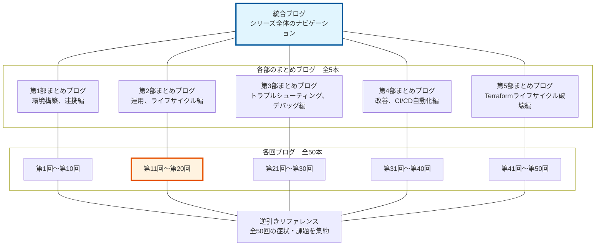

<style> table th, table td { word-break: normal; } table td:first-child { white-space: nowrap; } </style>

> **🗺️ 初めての方・シリーズの全体像を知りたい方はこちら**
> 
> シリーズ全体については、以下のまとめブログで整理しています。
> 
> → **[「AnsibleとTerraformの連携が壊れる理由はライフサイクルにあった」第2部まとめブログ： TerraformとAnsibleの運用で直面する構成ズレと状態管理の問題](https://qiita.com/juehara-crypto/items/c3e95e3bec11e07bbe75)**

---

> **🔍 今起きている症状・課題から、読むべき回を探したい方はこちら**
>
> 全50回で扱った症状・課題を、部をまたいで1か所に集めた逆引きリファレンスがあります。
> 症状・課題の一覧から原因の見当をつけ、該当する回のセクションまでたどれます。
>
> → **[「AnsibleとTerraformの連携が壊れる理由はライフサイクルにあった」逆引きリファレンス：全50回の症状・課題を5つの図から引く](https://qiita.com/juehara-crypto/items/bd2832993ef887e8022a)**

---

**※本記事の位置とシリーズ全体の関係を先に確認します。**

---

## 📍 本記事の位置



本シリーズは、**[統合ブログ](https://qiita.com/juehara-crypto/items/5bd6720b7aaed13757f8)**、第1〜5部のまとめブログ（全5本）、第1〜50回の各回ブログ（全50本）の3階層で構成されています。**現在はこの図の下段、第2部「第11回〜第20回」のうちの第17回になります。** 統合ブログとまとめブログは、シリーズを上から順に読み進めるための入口です。

また、この3階層とは別に、**[逆引きリファレンス](https://qiita.com/juehara-crypto/items/bd2832993ef887e8022a)** があります。第1〜50回の各回ブログで扱った症状・課題を、部をまたいで1か所に集め、今起きている症状や解決したい課題から、該当する回へ直接たどり着けるようにしたものです。

---

## 📋 目次

1. [はじめに](#1-はじめに)
2. [リソース再生成によるIPアドレス変動の発生](#2-リソース再生成によるipアドレス変動の発生)
3. [静的インベントリの書き換え漏れ](#3-静的インベントリの書き換え漏れ)
4. [動的インベントリによる自動追従](#4-動的インベントリによる自動追従)
5. [DNS・hosts設定との連動](#5-dnshosts設定との連動)
6. [連動の自動化パターン](#6-連動の自動化パターン)
7. [まとめ](#7-まとめ)
8. [次回予告](#8-次回予告)
9. [連載一覧：「AnsibleとTerraformの連携が壊れる理由はライフサイクルにあった」](#9-連載一覧ansibleとterraformの連携が壊れる理由はライフサイクルにあった)

---

## 1. はじめに

「コンテナを作り直しただけのつもりが、Ansibleが古い接続先にアクセスしようとして接続を拒否された」という経験はないでしょうか。

**[第16回](https://juehara-crypto.github.io/blog/infra/ansible/ansible-terraform/ansible-terraform-part2/ansible-terraform-part2-16/)** では、`apt update`／`apt upgrade`によるパッケージバージョンの変化という、時間の経過そのものによって環境がTerraformの定義から独立して進行していく問題を扱いました。今回扱うのは、これとは別の性質を持つ変化です。時間の経過ではなく、Terraformによる**リソースの再生成**というタイミングをきっかけに、環境が変化するケースを扱います。

このテーマは、これまでの回とも接続します。**[第5回](https://juehara-crypto.github.io/blog/infra/ansible/ansible-terraform/ansible-terraform-part1/ansible-terraform-part1-05/)** では、リソース再生成に伴うIPアドレス変動そのものと、Ansibleの接続失敗という構造を整理しました。**[第13回](https://juehara-crypto.github.io/blog/infra/ansible/ansible-terraform/ansible-terraform-part2/ansible-terraform-part2-13/)** では、同じくリソース再生成をきっかけに、Ansibleが投入したOS内部の設定そのものが消失する構造を確認しました。今回はこの2つの中間にある問題を扱います。OS内部の設定が消えるかどうかではなく、**IPアドレスという識別子そのものが変わる**ことによって、Ansibleのインベントリや、IPアドレスを参照している他の設定ファイルとの間に生じる「参照先のズレ」に焦点を当てます。

具体的には、次のような場面です。

* リソースを再生成した後、静的インベントリを書き換えずにAnsibleを実行し、古いIPアドレスへの接続が拒否された
* 動的インベントリに切り替えていたため、Ansible自体の接続は新しいIPアドレスに追従できた。しかし、IPアドレスをホスト名で参照している他の設定ファイル（DNS・`/etc/hosts`等）だけが古いままで、そちらは追従していなかった
* 「IPアドレスが変わった」という事実が、インベントリだけでなく、関連する複数の設定にどこまで、どう伝播していくのかが整理できていなかった

この回で扱う問いは、「リソース再生成によってIPアドレスという識別子が変わった事実を、どの仕組みでどこまで自動的に追従させられるか」です。第5回で扱ったIPアドレス変動と接続失敗という一般的な構造の再解説は行わず、Terraformによる意図的なリソース再生成というトリガーに限定したうえで、新しいIPアドレスがインベントリ・DNS・関連する設定ファイルへどう伝播していくかを見ていきます。

次のセクションでは、この回全体の前提となる、リソース再生成によってIPアドレスが変動する構造を、**[第5回](https://juehara-crypto.github.io/blog/infra/ansible/ansible-terraform/ansible-terraform-part1/ansible-terraform-part1-05/)**・**[第13回](https://juehara-crypto.github.io/blog/infra/ansible/ansible-terraform/ansible-terraform-part2/ansible-terraform-part2-13/)** の内容を踏まえて簡潔に整理します。

---

[↑ 目次に戻る](#-目次)

---

## 2. リソース再生成によるIPアドレス変動の発生

この回全体の前提となる構造を、**[第5回](https://juehara-crypto.github.io/blog/infra/ansible/ansible-terraform/ansible-terraform-part1/ansible-terraform-part1-05/)**・**[第13回](https://juehara-crypto.github.io/blog/infra/ansible/ansible-terraform/ansible-terraform-part2/ansible-terraform-part2-13/)** の内容を踏まえて簡潔に整理します。

Terraformが管理するリソースに、`terraform plan`で`forces replacement`と表示される変更が加わると、リソースは一度破棄され、新しく払い出されます。コンテナ、VM、クラウドリソースのいずれであっても、この破棄、再生成のタイミングで、IPアドレスが変わることがあります。IPアドレスをDockerネットワークやDHCPといった外部の仕組みが動的に決めている限り、再生成前と同じIPアドレスが再び割り当てられる保証はありません。

この構造自体は、**[第5回](https://juehara-crypto.github.io/blog/infra/ansible/ansible-terraform/ansible-terraform-part1/ansible-terraform-part1-05/)** ですでに確認したものです。第5回では、この再生成によるIPアドレス変動が、Ansibleの接続失敗や、さらには意図しないホストへの接続という形で表面化する様子を実機で確認しました。今回はこの一般的な構造そのものを扱い直すのではなく、この構造を前提として先に進みます。

一方、**[第13回](https://juehara-crypto.github.io/blog/infra/ansible/ansible-terraform/ansible-terraform-part2/ansible-terraform-part2-13/)** では、同じくリソースの破棄、再生成をきっかけに、Ansibleが投入したOS内部の設定（`/etc/app.conf`等）が消失する構造を確認しました。**[第13回](https://juehara-crypto.github.io/blog/infra/ansible/ansible-terraform/ansible-terraform-part2/ansible-terraform-part2-13/)** の焦点は、リソース内部にあったデータやファイルが、再生成という操作によって失われるという点にありました。

この2つの回と今回の関係を整理すると、次のようになります。

```plaintext
第5回：IPアドレス変動とAnsible接続への影響
第13回：リソース再生成によるOS内部の設定消失
第17回：リソース再生成によるIPアドレス変動が関連設定に波及する問題
```

**[第5回](https://juehara-crypto.github.io/blog/infra/ansible/ansible-terraform/ansible-terraform-part1/ansible-terraform-part1-05/)** と **[第13回](https://juehara-crypto.github.io/blog/infra/ansible/ansible-terraform/ansible-terraform-part2/ansible-terraform-part2-13/)** は、いずれも「リソースが再生成される」という同じ出来事を起点にしていますが、注目している対象が異なります。**[第5回](https://juehara-crypto.github.io/blog/infra/ansible/ansible-terraform/ansible-terraform-part1/ansible-terraform-part1-05/)** はAnsibleの接続先そのもの、**[第13回](https://juehara-crypto.github.io/blog/infra/ansible/ansible-terraform/ansible-terraform-part2/ansible-terraform-part2-13/)** はリソース内部の設定です。今回はそのどちらでもなく、**IPアドレスという識別子が変わった事実が、インベントリ以外の関連設定（DNS、`/etc/hosts`、他ノードの接続設定等）にどこまで、どう伝播していくか**という点に焦点を当てます。

Ansible自体の接続先の追従だけを考えるなら、**[第5回](https://juehara-crypto.github.io/blog/infra/ansible/ansible-terraform/ansible-terraform-part1/ansible-terraform-part1-05/)** で確認した動的インベントリという解決策がすでに存在します。しかし、IPアドレスを参照している箇所はAnsibleのインベントリだけとは限りません。ホスト名でリソース同士が参照し合う構成を取っている場合、IPアドレスが変わった事実は、インベントリの外側にも伝わる必要があります。この伝播の範囲と方法を整理することが、今回のテーマです。

次のセクションでは、まずインベントリの中でも書き換えが追いつきにくい静的インベントリを対象に、リソース再生成後にどのような問題が起きるかを実機で確認します。

---

[↑ 目次に戻る](#-目次)

---

## 3. 静的インベントリの書き換え漏れ

IPアドレスを直接記述した静的インベントリを使っている場合に、リソース再生成後どのような問題が起きるかを実機で確認します。

本検証環境の`inventory.ini`は、次のようにコンテナ名とIPアドレスを直接記述した静的な形式です。

* **ファイル名：**`inventory.ini`

```ini
[target_nodes]
target-node1 ansible_host=172.20.0.2 ansible_user=ansible
target-node2 ansible_host=172.20.0.3 ansible_user=ansible
target-node3 ansible_host=172.20.0.4 ansible_user=ansible
```

このファイルは、**[第5回](https://juehara-crypto.github.io/blog/infra/ansible/ansible-terraform/ansible-terraform-part1/ansible-terraform-part1-05/)** で確認した通り、`local_file.ansible_inventory`が`docker_container.targets`に依存する構成になっているため、`terraform apply`一回の実行の中では自動的に最新のIPアドレスへ書き換わります。つまり、現行の`inventory.ini`自体は、`apply`を実行するたびに最新のIPアドレスへ追従します。この回で確認したいのは、この自動更新が効かないケース、つまり`apply`実行時点の内容をコピーして手元で保持し続けた場合に何が起きるかです。以降の検証では、`inventory.ini`を退避コピーしたファイルを使い、これを手書きの静的インベントリに見立てて検証します。

### ■ 検証内容（静的インベントリを書き換えずに、リソース再生成後のIPアドレスへ接続を試みた場合の挙動確認）

まず、再生成前の状態でtarget-node2に正常に接続できることを確認します。

**実行コマンド**

```plaintext
ansible target-node2 -i ~/iac/docker-lab/inventory.ini -m ping
```

**▼ 実行結果**

```plaintext
[WARNING]: Platform linux on host target-node2 is using the discovered Python interpreter at /usr/bin/python3.10, but future installation of another Python interpreter could change the
meaning of that path. See https://docs.ansible.com/ansible-core/2.17/reference_appendices/interpreter_discovery.html for more information.
target-node2 | SUCCESS => {
    "ansible_facts": {
        "discovered_interpreter_python": "/usr/bin/python3.10"
    },
    "changed": false,
    "ping": "pong"
}
```

`SUCCESS`、`"ping": "pong"`が返り、この時点のインベントリで正常に接続できることを確認しました。次に、この時点のインベントリを退避します。

**実行コマンド**

```plaintext
cp ~/iac/docker-lab/inventory.ini ~/iac/docker-lab/inventory.ini.old_backup
```

続けて、target-node2を強制的に再生成します。IPアドレスをDockerネットワークが動的に割り当てる本検証環境では、再生成前と同じIPアドレスがそのまま再利用される場合があるため、一度リソースを解放したうえで、そのアドレスをダミーコンテナで占有してから作り直します。この手順は **[第5回](https://juehara-crypto.github.io/blog/infra/ansible/ansible-terraform/ansible-terraform-part1/ansible-terraform-part1-05/)** で使った、IPアドレスの再利用を避けるための準備と同じ考え方によるものです。

**実行コマンド**

```plaintext
terraform destroy -target="docker_container.targets[\"target-node2\"]"
```

**▼ 実行結果**

```plaintext
（…途中省略、各プロバイダーのRefreshing state…）
docker_container.targets["target-node2"]: Refreshing state... [id=d5b26bf303a80955daf3f0f9d2fe42900eeed8bad81270b6135cc8723e7663d2]

Terraform used the selected providers to generate the following execution plan. Resource actions are indicated with the following symbols:
  - destroy

Terraform will perform the following actions:

  # docker_container.targets["target-node2"] will be destroyed
  - resource "docker_container" "targets" {
      - attach                                      = false -> null
      - command                                     = [
          - "/usr/sbin/sshd",
          - "-D",
        ] -> null
      - container_read_refresh_timeout_milliseconds = 15000 -> null
      - cpu_shares                                  = 0 -> null
      - dns                                         = [] -> null
      - dns_opts                                    = [] -> null
      - dns_search                                  = [] -> null
      - entrypoint                                  = [] -> null
      - env                                         = [] -> null
      - group_add                                   = [] -> null
      - hostname                                    = "d5b26bf303a8" -> null
      - id                                          = "d5b26bf303a80955daf3f0f9d2fe42900eeed8bad81270b6135cc8723e7663d2" -> null
      - image                                       = "sha256:3557c4c7ab005be7a378a329a5ca402ec4ae742c0b158cf872f2efe01bdb4a30" -> null
      - init                                        = false -> null
      - ipc_mode                                    = "private" -> null
      - log_driver                                  = "json-file" -> null
      - log_opts                                    = {} -> null
      - logs                                        = false -> null
      - max_retry_count                             = 0 -> null
      - memory                                      = 0 -> null
      - memory_swap                                 = 0 -> null
      - must_run                                    = true -> null
      - name                                        = "target-node2" -> null
      - network_data                                = [
          - {
              - gateway                   = "172.20.0.1"
              - global_ipv6_prefix_length = 0
              - ip_address                = "172.20.0.3"
              - ip_prefix_length          = 24
              - mac_address               = "7e:44:76:18:85:10"
              - network_name              = "ansible-lab-net"
                # (2 unchanged attributes hidden)
            },
        ] -> null
      - network_mode                                = "bridge" -> null
      - privileged                                  = false -> null
      - publish_all_ports                           = false -> null
      - read_only                                   = false -> null
      - remove_volumes                              = true -> null
      - restart                                     = "no" -> null
      - rm                                          = false -> null
      - runtime                                     = "runc" -> null
      - security_opts                               = [] -> null
      - shm_size                                    = 64 -> null
      - start                                       = true -> null
      - stdin_open                                  = false -> null
      - stop_timeout                                = 0 -> null
      - storage_opts                                = {} -> null
      - sysctls                                     = {} -> null
      - tmpfs                                       = {} -> null
      - tty                                         = false -> null
      - wait                                        = false -> null
      - wait_timeout                                = 60 -> null
        # (8 unchanged attributes hidden)

      - networks_advanced {
          - aliases      = [] -> null
          - name         = "ansible-lab-net" -> null
            # (2 unchanged attributes hidden)
        }

      - ports {
          - external = 2222 -> null
          - internal = 22 -> null
          - ip       = "0.0.0.0" -> null
          - protocol = "tcp" -> null
        }

      - upload {
          - content        = <<-EOT
                init_version=v1
            EOT -> null
          - executable     = false -> null
          - file           = "/etc/init_marker" -> null
            # (3 unchanged attributes hidden)
        }
      - upload {
          - content        = <<-EOT
                ssh-ed25519 AAAAC3NzaC1lZDI1NTE5AAAAIJ9ZflEAp+DdFuvvm/+Y7HhfCtg0n51gm5xN4IfNH9aM control@ubuntu-controller

                ssh-ed25519 AAAAC3NzaC1lZDI1NTE5AAAAIBNq1AJD66jrCFzItazhDFMeajO6eQmK6S5Eb//xB8aB
            EOT -> null
          - executable     = false -> null
          - file           = "/home/ansible/.ssh/authorized_keys" -> null
            # (3 unchanged attributes hidden)
        }
    }

  # local_file.ansible_inventory will be destroyed
  - resource "local_file" "ansible_inventory" {
      - content              = <<-EOT
            [target_nodes]
            target-node1 ansible_host=172.20.0.2 ansible_user=ansible
            target-node2 ansible_host=172.20.0.3 ansible_user=ansible
            target-node3 ansible_host=172.20.0.4 ansible_user=ansible
        EOT -> null
        # (中略：content_base64sha256等のハッシュ値差分)
    }

  # null_resource.provision will be destroyed
  - resource "null_resource" "provision" {
      - id = "6937146635947666853" -> null
    }

Plan: 0 to add, 0 to change, 3 to destroy.
╷
│ Warning: Resource targeting is in effect
│
│ You are creating a plan with the -target option, which means that the result of this plan may not represent all of the changes requested by the current configuration.
╵

Do you really want to destroy all resources?
  Terraform will destroy all your managed infrastructure, as shown above.
  There is no undo. Only 'yes' will be accepted to confirm.

  Enter a value: yes

null_resource.provision: Destroying... [id=6937146635947666853]
null_resource.provision: Destruction complete after 0s
local_file.ansible_inventory: Destroying... [id=5be39bf94b8b814c5107e1a0cf2248e68b7e1ff8]
local_file.ansible_inventory: Destruction complete after 0s
docker_container.targets["target-node2"]: Destroying... [id=d5b26bf303a80955daf3f0f9d2fe42900eeed8bad81270b6135cc8723e7663d2]
docker_container.targets["target-node2"]: Destruction complete after 1s
╷
│ Warning: Applied changes may be incomplete
│
│ The plan was created with the -target option in effect, so some changes requested in the configuration may have been ignored and the output values may not be fully updated.
╵

Destroy complete! Resources: 3 destroyed.
```

target-node2が破棄され、`172.20.0.3`が解放されました。このアドレスをダミーコンテナで明示的に占有します。

**実行コマンド**

```plaintext
docker run -d --name ip-occupant --network ansible-lab-net --ip 172.20.0.3 alpine sleep 3600
```

**▼ 実行結果**

```plaintext
17d7f6596d8584a57188bb441102cfe6fe392779b9d701bf627eb24e9649c60f
```

この状態でtarget-node2を作り直します。

**実行コマンド**

```plaintext
terraform apply
```

**▼ 実行結果**

```plaintext
（…途中省略、各プロバイダーのRefreshing state…）
docker_container.targets["target-node3"]: Refreshing state... [id=c0bf3acaad8594c22759d078da57ecea563acd09c383d5c0cd8e8eabb32ba1ea]

Terraform used the selected providers to generate the following execution plan. Resource actions are indicated with the following symbols:
  + create

Terraform will perform the following actions:

  # docker_container.targets["target-node2"] will be created
  + resource "docker_container" "targets" {
      + attach                                      = false
      + bridge                                      = (known after apply)
      + command                                     = (known after apply)
      + container_logs                              = (known after apply)
      + container_read_refresh_timeout_milliseconds = 15000
      + entrypoint                                  = (known after apply)
      + env                                         = (known after apply)
      + exit_code                                   = (known after apply)
      + hostname                                    = (known after apply)
      + id                                          = (known after apply)
      + image                                       = "sha256:3557c4c7ab005be7a378a329a5ca402ec4ae742c0b158cf872f2efe01bdb4a30"
      + init                                        = (known after apply)
      + ipc_mode                                    = (known after apply)
      + log_driver                                  = (known after apply)
      + logs                                        = false
      + must_run                                    = true
      + name                                        = "target-node2"
      + network_data                                = (known after apply)
      + read_only                                   = false
      + remove_volumes                              = true
      + restart                                     = "no"
      + rm                                          = false
      + runtime                                     = (known after apply)
      + security_opts                               = (known after apply)
      + shm_size                                    = (known after apply)
      + start                                       = true
      + stdin_open                                  = false
      + stop_signal                                 = (known after apply)
      + stop_timeout                                = (known after apply)
      + tty                                         = false
      + wait                                        = false
      + wait_timeout                                = 60

      + healthcheck (known after apply)

      + labels (known after apply)

      + networks_advanced {
          + aliases      = []
          + name         = "ansible-lab-net"
            # (2 unchanged attributes hidden)
        }

      + ports {
          + external = 2222
          + internal = 22
          + ip       = "0.0.0.0"
          + protocol = "tcp"
        }

      + upload {
          + content        = <<-EOT
                init_version=v1
            EOT
          + executable     = false
          + file           = "/etc/init_marker"
            # (3 unchanged attributes hidden)
        }
      + upload {
          + content        = <<-EOT
                ssh-ed25519 AAAAC3NzaC1lZDI1NTE5AAAAIJ9ZflEAp+DdFuvvm/+Y7HhfCtg0n51gm5xN4IfNH9aM control@ubuntu-controller

                ssh-ed25519 AAAAC3NzaC1lZDI1NTE5AAAAIBNq1AJD66jrCFzItazhDFMeajO6eQmK6S5Eb//xB8aB
            EOT
          + executable     = false
          + file           = "/home/ansible/.ssh/authorized_keys"
            # (3 unchanged attributes hidden)
        }
    }

  # local_file.ansible_inventory will be created
  + resource "local_file" "ansible_inventory" {
      + content              = (known after apply)
      + content_base64sha256 = (known after apply)
      + content_base64sha512 = (known after apply)
      + content_md5          = (known after apply)
      + content_sha1         = (known after apply)
      + content_sha256       = (known after apply)
      + content_sha512       = (known after apply)
      + directory_permission = "0777"
      + file_permission      = "0777"
      + filename             = "./inventory.ini"
      + id                   = (known after apply)
    }

  # null_resource.provision will be created
  + resource "null_resource" "provision" {
      + id = (known after apply)
    }

Plan: 3 to add, 0 to change, 0 to destroy.

Changes to Outputs:
  ~ target_nodes_ips = {
      ~ target-node2 = "172.20.0.3" -> (known after apply)
        # (2 unchanged attributes hidden)
    }

Do you want to perform these actions?
  Terraform will perform the actions described above.
  Only 'yes' will be accepted to approve.

  Enter a value: yes

docker_container.targets["target-node2"]: Creating...
docker_container.targets["target-node2"]: Creation complete after 1s [id=d5146d4afdaf32dfd4ad41fc312afa6e01e64e71a15a9ab2a46aa69e28f98480]
local_file.ansible_inventory: Creating...
local_file.ansible_inventory: Creation complete after 0s [id=dd492a47b6e469e6ce90401f941e94d95d871c25]
null_resource.provision: Creating...
null_resource.provision: Provisioning with 'local-exec'...
null_resource.provision (local-exec): Executing: ["/bin/sh" "-c" "ANSIBLE_SSH_RETRIES=0 ansible all -i inventory.ini -m ping > ansible_result.log 2>&1; cat ansible_result.log"]
null_resource.provision (local-exec): [WARNING]: Platform linux on host target-node3 is using the discovered Python
null_resource.provision (local-exec): interpreter at /usr/bin/python3.10, but future installation of another Python
null_resource.provision (local-exec): interpreter could change the meaning of that path. See
null_resource.provision (local-exec): https://docs.ansible.com/ansible-
null_resource.provision (local-exec): core/2.17/reference_appendices/interpreter_discovery.html for more information.
null_resource.provision (local-exec): [WARNING]: Platform linux on host target-node1 is using the discovered Python
null_resource.provision (local-exec): interpreter at /usr/bin/python3.10, but future installation of another Python
null_resource.provision (local-exec): interpreter could change the meaning of that path. See
null_resource.provision (local-exec): https://docs.ansible.com/ansible-
null_resource.provision (local-exec): core/2.17/reference_appendices/interpreter_discovery.html for more information.
null_resource.provision (local-exec): [WARNING]: Platform linux on host target-node2 is using the discovered Python
null_resource.provision (local-exec): interpreter at /usr/bin/python3.10, but future installation of another Python
null_resource.provision (local-exec): interpreter could change the meaning of that path. See
null_resource.provision (local-exec): https://docs.ansible.com/ansible-
null_resource.provision (local-exec): core/2.17/reference_appendices/interpreter_discovery.html for more information.
null_resource.provision (local-exec): target-node3 | SUCCESS => {
null_resource.provision (local-exec):     "ansible_facts": {
null_resource.provision (local-exec):         "discovered_interpreter_python": "/usr/bin/python3.10"
null_resource.provision (local-exec):     },
null_resource.provision (local-exec):     "changed": false,
null_resource.provision (local-exec):     "ping": "pong"
null_resource.provision (local-exec): }
null_resource.provision (local-exec): target-node1 | SUCCESS => {
null_resource.provision (local-exec):     "ansible_facts": {
null_resource.provision (local-exec):         "discovered_interpreter_python": "/usr/bin/python3.10"
null_resource.provision (local-exec):     },
null_resource.provision (local-exec):     "changed": false,
null_resource.provision (local-exec):     "ping": "pong"
null_resource.provision (local-exec): }
null_resource.provision (local-exec): target-node2 | SUCCESS => {
null_resource.provision (local-exec):     "ansible_facts": {
null_resource.provision (local-exec):         "discovered_interpreter_python": "/usr/bin/python3.10"
null_resource.provision (local-exec):     },
null_resource.provision (local-exec):     "changed": false,
null_resource.provision (local-exec):     "ping": "pong"
null_resource.provision (local-exec): }
null_resource.provision: Creation complete after 3s [id=8077859928770047270]

Apply complete! Resources: 3 added, 0 changed, 0 destroyed.

Outputs:

target_nodes_ips = {
  "target-node1" = "172.20.0.2"
  "target-node2" = "172.20.0.5"
  "target-node3" = "172.20.0.4"
}
```

target-node2のIPアドレスが`172.20.0.3`から`172.20.0.5`に変わりました。この時点で、退避しておいた`inventory.ini.old_backup`には、古いIPアドレス（`172.20.0.3`）がそのまま残っています。

この状態で、あえて古いインベントリを使ってAnsibleを実行します。

**実行コマンド**

```plaintext
ansible target-node2 -i ~/iac/docker-lab/inventory.ini.old_backup -m ping
```

**▼ 実行結果**

```plaintext
target-node2 | UNREACHABLE! => {
    "changed": false,
    "msg": "Failed to connect to the host via ssh: ssh: connect to host 172.20.0.3 port 22: Connection refused",
    "unreachable": true
}
```

### ■ 結果

IPアドレスが変わっているにもかかわらず、`inventory.ini.old_backup`は古いIPアドレス（`172.20.0.3`）を参照したままだったため、Ansibleは古い接続先への接続を試み、`UNREACHABLE`という結果になりました。

このファイルは、`terraform apply`を実行した瞬間には最新のIPアドレスを反映していますが、書き出された後は単なる静的なテキストファイルにすぎません。その後にリソースが再生成されても、ファイル自身が変化を検知して内容を書き換えることはなく、誰かが手動で更新しない限り、古い接続情報を参照し続けます。

今回は退避コピーを使ってこの状況を再現しましたが、実務で同じ状況が起きるのは、`apply`実行時点のインベントリをコピーして使い回す、あるいは手書きで管理している場合です。再生成の頻度が上がるほどこの種の書き換え漏れのリスクが高まるという見立ては、ここでは実測していない推測です。次のセクションでは、この手動更新そのものを不要にする、動的インベントリによる解決策を確認します。

---

[↑ 目次に戻る](#-目次)

---

## 4. 動的インベントリによる自動追従

セクション3で確認した問題に対する解決パターンを示します。

**[第3回](https://juehara-crypto.github.io/blog/infra/ansible/ansible-terraform/ansible-terraform-part1/ansible-terraform-part1-03/)** で作成した動的インベントリスクリプト`inventory.py`を、変更せずそのまま使用します。このスクリプトは、Ansibleから`--list`付きで呼び出されるたびに`terraform output -json target_nodes_ips`を実行し、その時点の最新の接続情報を取得してAnsibleが要求する形式に整形します。ファイルとして内容を保存しておく静的インベントリとは異なり、呼び出しのたびにTerraformの現在の状態を問い合わせる点が、セクション3で確認した問題への対策になります。

なお、このスクリプトはAnsible実行時に`terraform`コマンドを直接呼び出す構成であり、**[第15回](https://juehara-crypto.github.io/blog/infra/ansible/ansible-terraform/ansible-terraform-part2/ansible-terraform-part2-15/)** で整理した「Ansible担当はtfstateや`terraform apply`に関与しない」という権限設計とは別の構成です。ここでは、IPアドレス変動への追従という仕組みそのものを示すことを優先し、この構成を使用します。チーム運用における権限分離の観点は第15回を参照してください。

* **ファイル名：**`inventory.py`（**[第3回](https://juehara-crypto.github.io/blog/infra/ansible/ansible-terraform/ansible-terraform-part1/ansible-terraform-part1-03/)**・**[第5回](https://juehara-crypto.github.io/blog/infra/ansible/ansible-terraform/ansible-terraform-part1/ansible-terraform-part1-05/)** から変更なし）

```python
#!/usr/bin/env python3
import argparse
import json
import subprocess

def get_terraform_output():
    result = subprocess.run(
        ["terraform", "output", "-json", "target_nodes_ips"],
        capture_output=True, text=True, check=True
    )
    return json.loads(result.stdout)

def build_inventory():
    nodes = get_terraform_output()
    return {
        "all": {
            "hosts": list(nodes.keys()),
            "vars": {}
        },
        "_meta": {
            "hostvars": {
                name: {"ansible_host": ip, "ansible_user": "ansible"}
                for name, ip in nodes.items()
            }
        }
    }

def main():
    parser = argparse.ArgumentParser()
    group = parser.add_mutually_exclusive_group(required=True)
    group.add_argument("--list", action="store_true")
    group.add_argument("--host")
    args = parser.parse_args()
    if args.list:
        print(json.dumps(build_inventory()))
    else:
        print(json.dumps({}))

if __name__ == "__main__":
    main()
```

### ■ 検証内容（動的インベントリが、リソース再生成後もファイルの更新を待たず接続できることの確認）

まず、再生成前の状態でtarget-node2に正常に接続できることを確認します。

**実行コマンド**

```plaintext
ansible target-node2 -i ~/iac/docker-lab/inventory.py -m ping
```

**▼ 実行結果**

```plaintext
[WARNING]: Platform linux on host target-node2 is using the discovered Python interpreter at /usr/bin/python3.10, but future installation of another Python interpreter could change the
meaning of that path. See https://docs.ansible.com/ansible-core/2.17/reference_appendices/interpreter_discovery.html for more information.
target-node2 | SUCCESS => {
    "ansible_facts": {
        "discovered_interpreter_python": "/usr/bin/python3.10"
    },
    "changed": false,
    "ping": "pong"
}
```

正常に接続できることを確認したうえで、target-node2を再度強制的に再生成します。手順はセクション3と同様に、リソースを破棄し、解放されたIPアドレスをダミーコンテナで占有したうえで作り直します。

**実行コマンド**

```plaintext
terraform destroy -target="docker_container.targets[\"target-node2\"]"
```

**▼ 実行結果**

```plaintext
（…途中省略、各プロバイダーのRefreshing state…）
docker_container.targets["target-node2"]: Refreshing state... [id=d5146d4afdaf32dfd4ad41fc312afa6e01e64e71a15a9ab2a46aa69e28f98480]

Terraform used the selected providers to generate the following execution plan. Resource actions are indicated with the following symbols:
  - destroy

Terraform will perform the following actions:

  # docker_container.targets["target-node2"] will be destroyed
  - resource "docker_container" "targets" {
      - attach                                      = false -> null
      - command                                     = [
          - "/usr/sbin/sshd",
          - "-D",
        ] -> null
        # (中略：セクション3と同様の属性一覧)
      - name                                        = "target-node2" -> null
      - network_data                                = [
          - {
              - gateway                   = "172.20.0.1"
              - global_ipv6_prefix_length = 0
              - ip_address                = "172.20.0.5"
              - ip_prefix_length          = 24
              - mac_address               = "1a:00:82:f7:06:b6"
              - network_name              = "ansible-lab-net"
                # (2 unchanged attributes hidden)
            },
        ] -> null
        # (中略：network_mode以下、ports、uploadブロック)
    }

  # local_file.ansible_inventory will be destroyed
  - resource "local_file" "ansible_inventory" {
        # (中略：content、ハッシュ値差分)
    }

  # null_resource.provision will be destroyed
  - resource "null_resource" "provision" {
      - id = "8077859928770047270" -> null
    }

Plan: 0 to add, 0 to change, 3 to destroy.
╷
│ Warning: Resource targeting is in effect
╵

Do you really want to destroy all resources?
  Terraform will destroy all your managed infrastructure, as shown above.
  There is no undo. Only 'yes' will be accepted to confirm.

  Enter a value: yes

null_resource.provision: Destroying... [id=8077859928770047270]
null_resource.provision: Destruction complete after 0s
local_file.ansible_inventory: Destroying... [id=dd492a47b6e469e6ce90401f941e94d95d871c25]
local_file.ansible_inventory: Destruction complete after 0s
docker_container.targets["target-node2"]: Destroying... [id=d5146d4afdaf32dfd4ad41fc312afa6e01e64e71a15a9ab2a46aa69e28f98480]
docker_container.targets["target-node2"]: Destruction complete after 2s
╷
│ Warning: Applied changes may be incomplete
╵

Destroy complete! Resources: 3 destroyed.
```

**実行コマンド**

```plaintext
docker run -d --name ip-occupant-2 --network ansible-lab-net --ip 172.20.0.5 alpine sleep 3600
```

**▼ 実行結果**

```plaintext
19a1e4ec831b228071d2309c91a2deb71a13e9c02de9b07b7baac3db463fdb9a
```

**実行コマンド**

```plaintext
terraform apply
```

**▼ 実行結果**

```plaintext
（…途中省略、各プロバイダーのRefreshing state…）
docker_container.targets["target-node1"]: Refreshing state... [id=2dacb702c37e4ef0af967e2a09467936cd99653d2b9223042600fe3d522e867f]

Terraform used the selected providers to generate the following execution plan. Resource actions are indicated with the following symbols:
  + create

Terraform will perform the following actions:

  # docker_container.targets["target-node2"] will be created
  + resource "docker_container" "targets" {
        # (中略：attach以下、command、container_logs等の生成属性)
      + name                                        = "target-node2"
      + network_data                                = (known after apply)
        # (中略：read_only以下、healthcheck、labels)

      + networks_advanced {
          + aliases      = []
          + name         = "ansible-lab-net"
            # (2 unchanged attributes hidden)
        }

      + ports {
          + external = 2222
          + internal = 22
          + ip       = "0.0.0.0"
          + protocol = "tcp"
        }

      + upload {
          + content        = <<-EOT
                init_version=v1
            EOT
          + executable     = false
          + file           = "/etc/init_marker"
            # (3 unchanged attributes hidden)
        }
      + upload {
          + content        = <<-EOT
                ssh-ed25519 AAAAC3NzaC1lZDI1NTE5AAAAIJ9ZflEAp+DdFuvvm/+Y7HhfCtg0n51gm5xN4IfNH9aM control@ubuntu-controller

                ssh-ed25519 AAAAC3NzaC1lZDI1NTE5AAAAIBNq1AJD66jrCFzItazhDFMeajO6eQmK6S5Eb//xB8aB
            EOT
          + executable     = false
          + file           = "/home/ansible/.ssh/authorized_keys"
            # (3 unchanged attributes hidden)
        }
    }

  # local_file.ansible_inventory will be created
  + resource "local_file" "ansible_inventory" {
        # (中略：content以下、ハッシュ値・パーミッション項目)
    }

  # null_resource.provision will be created
  + resource "null_resource" "provision" {
      + id = (known after apply)
    }

Plan: 3 to add, 0 to change, 0 to destroy.

Changes to Outputs:
  ~ target_nodes_ips = {
      ~ target-node2 = "172.20.0.5" -> (known after apply)
        # (2 unchanged attributes hidden)
    }

Do you want to perform these actions?
  Terraform will perform the actions described above.
  Only 'yes' will be accepted to approve.

  Enter a value: yes

docker_container.targets["target-node2"]: Creating...
docker_container.targets["target-node2"]: Creation complete after 3s [id=2c42482c3ba9c43bd40621b90416b405323c8a6d4e09837d10ea455c58e6614d]
local_file.ansible_inventory: Creating...
local_file.ansible_inventory: Creation complete after 0s [id=4d782ddc4bb331aa4c91429bfe03443a74abb2ca]
null_resource.provision: Creating...
null_resource.provision: Provisioning with 'local-exec'...
null_resource.provision (local-exec): Executing: ["/bin/sh" "-c" "ANSIBLE_SSH_RETRIES=0 ansible all -i inventory.ini -m ping > ansible_result.log 2>&1; cat ansible_result.log"]
null_resource.provision (local-exec): [WARNING]: Platform linux on host target-node1 is using the discovered Python
null_resource.provision (local-exec): interpreter at /usr/bin/python3.10, but future installation of another Python
null_resource.provision (local-exec): interpreter could change the meaning of that path. See
null_resource.provision (local-exec): https://docs.ansible.com/ansible-
null_resource.provision (local-exec): core/2.17/reference_appendices/interpreter_discovery.html for more information.
null_resource.provision (local-exec): [WARNING]: Platform linux on host target-node3 is using the discovered Python
null_resource.provision (local-exec): interpreter at /usr/bin/python3.10, but future installation of another Python
null_resource.provision (local-exec): interpreter could change the meaning of that path. See
null_resource.provision (local-exec): https://docs.ansible.com/ansible-
null_resource.provision (local-exec): core/2.17/reference_appendices/interpreter_discovery.html for more information.
null_resource.provision (local-exec): [WARNING]: Platform linux on host target-node2 is using the discovered Python
null_resource.provision (local-exec): interpreter at /usr/bin/python3.10, but future installation of another Python
null_resource.provision (local-exec): interpreter could change the meaning of that path. See
null_resource.provision (local-exec): https://docs.ansible.com/ansible-
null_resource.provision (local-exec): core/2.17/reference_appendices/interpreter_discovery.html for more information.
null_resource.provision (local-exec): target-node1 | SUCCESS => {
null_resource.provision (local-exec):     "ansible_facts": {
null_resource.provision (local-exec):         "discovered_interpreter_python": "/usr/bin/python3.10"
null_resource.provision (local-exec):     },
null_resource.provision (local-exec):     "changed": false,
null_resource.provision (local-exec):     "ping": "pong"
null_resource.provision (local-exec): }
null_resource.provision (local-exec): target-node3 | SUCCESS => {
null_resource.provision (local-exec):     "ansible_facts": {
null_resource.provision (local-exec):         "discovered_interpreter_python": "/usr/bin/python3.10"
null_resource.provision (local-exec):     },
null_resource.provision (local-exec):     "changed": false,
null_resource.provision (local-exec):     "ping": "pong"
null_resource.provision (local-exec): }
null_resource.provision (local-exec): target-node2 | SUCCESS => {
null_resource.provision (local-exec):     "ansible_facts": {
null_resource.provision (local-exec):         "discovered_interpreter_python": "/usr/bin/python3.10"
null_resource.provision (local-exec):     },
null_resource.provision (local-exec):     "changed": false,
null_resource.provision (local-exec):     "ping": "pong"
null_resource.provision (local-exec): }
null_resource.provision: Creation complete after 5s [id=5876942731684570095]

Apply complete! Resources: 3 added, 0 changed, 0 destroyed.

Outputs:

target_nodes_ips = {
  "target-node1" = "172.20.0.2"
  "target-node2" = "172.20.0.6"
  "target-node3" = "172.20.0.4"
}
```

target-node2のIPアドレスが`172.20.0.6`に変わりました。この状態で、ファイルの更新を一切挟まず、`inventory.py`経由でそのまま接続を試みます。

**実行コマンド**

```plaintext
ansible target-node2 -i ~/iac/docker-lab/inventory.py -m ping
```

**▼ 実行結果**

```plaintext
[WARNING]: Platform linux on host target-node2 is using the discovered Python interpreter at /usr/bin/python3.10, but future installation of another Python interpreter could change the
meaning of that path. See https://docs.ansible.com/ansible-core/2.17/reference_appendices/interpreter_discovery.html for more information.
target-node2 | SUCCESS => {
    "ansible_facts": {
        "discovered_interpreter_python": "/usr/bin/python3.10"
    },
    "changed": false,
    "ping": "pong"
}
```

### ■ 結果

新しいIPアドレス（`172.20.0.6`）に対して、`SUCCESS`、`"ping": "pong"`が返りました。セクション3では、同じ状況（再生成後、ファイルを更新しないまま接続を試みる）で`UNREACHABLE`という結果になりましたが、動的インベントリを使った今回は、そのまま正常に接続できています。

この違いは、インベントリの情報がどこに保持されているかという点に起因します。静的インベントリは、ある時点でのIPアドレスをファイルという形で固定的に保持するため、その後の変化には追従できません。一方、動的インベントリは接続情報をファイルとして保存せず、実行のたびにTerraformの現在の状態（`terraform output`）を都度問い合わせます。そのため、リソースが再生成されていても、実行時点での最新のIPアドレスがそのまま使われます。

手動でのファイル更新という手順そのものが不要になる点が、動的インベントリの利点です。ただし、ここで追従しているのはTerraformの現在の状態（tfstate）であり、実際のリソースの状態そのものではありません。`apply`の外でコンテナが再起動、再生成された場合など、tfstateがまだその変化を反映していない状況では、`terraform output`も古い値を返します。動的インベントリが保証しているのは「常に最新のIPアドレスが分かる」ことではなく、「Terraformの状態に追従する」ことです。再生成の頻度が高い環境ほど、この追従の効果は大きくなります。

---

[↑ 目次に戻る](#-目次)

---

## 5. DNS・hosts設定との連動

セクション3、4ではAnsibleのインベントリを対象に、静的な参照と動的な参照の違いを確認しました。ここでは視点を広げ、Ansibleのインベントリ以外にもIPアドレスを参照している箇所がある場合に何が起きるかを整理します。

セクション4で確認した通り、動的インベントリを使えば、Ansible自体の接続先はTerraformの現在の状態に自動的に追従します。しかし、IPアドレスを参照しているのは、Ansibleのインベントリだけとは限りません。次のような場面では、動的インベントリだけでは解決できない参照が残ります。

* 複数のリソースを構築する構成で、あるノードの設定ファイルが、別のノードをホスト名やIPアドレスで直接参照している場合（アプリケーションサーバーの設定ファイルが、データベースサーバーのホスト名を記述しているようなケース）
* コンテナやVMの内部で動作するアプリケーションが、自身の設定ファイルの中に、連携先の他リソースのIPアドレスを保持している場合
* `/etc/hosts`のような、OS内部の名前解決の仕組みに、他リソースのIPアドレスが直接書き込まれている場合

これらはいずれも、Ansibleのインベントリとは別に、IPアドレスが**リソースの内部**に記録されているケースです。動的インベントリが解決するのは、あくまで「Ansibleがどのホストにどう接続するか」という、Ansible実行時の接続経路の問題です。リソース内部に書き込まれた設定ファイルの中身までは、動的インベントリの仕組みは関与しません。

```plaintext
動的インベントリが解決する範囲：Ansible実行時の接続先（ansible_host）
動的インベントリが解決しない範囲：リソース内部の設定ファイルが保持するIPアドレスやホスト名
```

このズレが実際にどう表面化するかを整理します。あるリソースが再生成され、IPアドレスが変わったとします。Ansible側は動的インベントリによって新しいIPアドレスに正しく接続できます。しかし、他のリソースの内部に、変更前のIPアドレスやホスト名を前提にした設定ファイルが存在していた場合、その設定ファイルの中身は再生成のタイミングでは一切更新されません。Ansibleの接続自体は成功しているため、この参照切れは、Ansibleの実行結果だけを見ていては気づけません。気づくのは、リソース間の通信そのものが失敗した時点、つまりアプリケーションレベルの障害として現れた時点になります。

対処の方向性は、大きく2つに分かれます。

1つは、参照する側の設定ファイルに、IPアドレスやホスト名を直接書き込まないという設計です。ホスト名で参照する場合は、DNSサーバーやDockerネットワークの内蔵DNS機能など、名前解決の仕組みを経由させ、参照先の実体が変わってもホスト名自体は変わらないようにします。この場合、IPアドレスが変わっても、DNS側の登録さえ更新されれば、参照する側の設定ファイル自体は書き換える必要がありません。

もう1つは、リソース再生成のタイミングに合わせて、関連する設定ファイルの更新も連動させるという設計です。この場合、DNSレコードの更新や`/etc/hosts`の書き換えを、IPアドレスの変動が起きた際に自動的に実行する仕組みが必要になります。

ここまでの整理でも分かる通り、「IPアドレスが変わった事実」は、インベントリという1つの参照先だけの問題ではなく、その事実を参照している箇所すべてに伝播する必要がある問題です。次のセクションでは、この伝播をどう自動化するか、2つの方向性を整理します。

---

[↑ 目次に戻る](#-目次)

---

## 6. 連動の自動化パターン

セクション4、5を踏まえ、IPアドレス変動を関連設定全体に連動させる設計パターンを整理します。

セクション4では動的インベントリによってAnsibleの接続先を都度解決する方法を、セクション5ではインベントリの外側にある参照（DNS・設定ファイル等）にも同様の追従が必要になることを確認しました。この2つを踏まえると、IPアドレス変動への対応は、大きく2つの方向性に整理できます。

### 方向性A：イベント駆動でまとめて更新する

`terraform apply`が完了したタイミングを起点として、関連する更新処理をまとめて実行する方向性です。`local-exec`プロビジョナーを使い、`apply`完了直後にインベントリ更新やDNS更新のスクリプトを連続実行する構成が、この方向性にあたります。

```hcl
provisioner "local-exec" {
  command = "update_hosts.sh && ansible-playbook -i inventory_script.py playbook.yml"
}
```

この方向性の考え方は、「IPアドレスが変わった」というイベントの発生時点で、影響を受けるすべての設定を一斉に更新してしまうというものです。更新対象が増えるほど、`apply`完了後に実行するスクリプトの数や順序管理が複雑になります。この`local-exec`の例は実機検証を行っておらず、構成として考えられる形の説明です。

### 方向性B：都度解決で常に最新状態を参照する

実行のたびに、参照先の現在の状態を都度取得する方向性です。セクション4で確認した動的インベントリは、この方向性の一例にあたります。DNSについても、固定的なレコード更新に頼るのではなく、参照する側が都度名前解決を行う仕組みにしておけば、IPアドレスが変わった時点でDNS側のレコードさえ更新されていれば、参照する側の処理を個別に書き換える必要はありません。

この方向性の考え方は、「特定の時点の状態をファイルや設定として固定しない」というものです。実行のたびに最新の状態を問い合わせるため、更新のし忘れという問題自体が起こりません。一方で、参照するたびに問い合わせが発生するため、参照先の数が多い、あるいは参照の頻度が高い構成では、問い合わせにかかるコストが積み重なります。

### 判断軸

どちらの方向性を採用するかは、次の2つの観点で判断が分かれます。

|観点|方向性Aが向いている場合|方向性Bが向いている場合|
|---|---|---|
|再生成の頻度|低い（更新処理の実行回数が少なく済む）|高い（都度解決の方が更新漏れのリスクを避けられる）|
|関連設定の複雑さ|シンプル（更新対象が少なく、スクリプトの管理がしやすい）|複雑（都度解決に任せた方が、個別の更新ロジックを持たずに済む）|

再生成が頻繁に起こり、かつ関連設定が複雑な環境では、方向性Bの都度解決が扱いやすくなります。逆に、再生成がまれにしか起こらず、関連設定がシンプルな環境では、都度の問い合わせコストをかけるよりも、変化が起きたタイミングでまとめて更新する方向性Aの方が扱いやすくなります。

この2つの方向性は、セクション3、4で確認した静的インベントリと動的インベントリの対比と、同じ構造を持っています。ファイルとして状態を固定するか、実行のたびに現在の状態を問い合わせるか、という選択は、インベントリという1つの参照先に限らず、IPアドレスを参照するあらゆる箇所に共通する設計判断です。

---

[↑ 目次に戻る](#-目次)

---

## 7. まとめ

この回で整理した内容を確認します。

* Terraformによるリソース再生成では、IPアドレスが変わることがある（本検証環境では、元のアドレスが空いていると同じアドレスが再利用されることもある）。この変動自体は **[第5回](https://juehara-crypto.github.io/blog/infra/ansible/ansible-terraform/ansible-terraform-part1/ansible-terraform-part1-05/)** で確認済みの構造であり、今回はこの構造を前提として、IPアドレス変動が関連設定にどう波及するかに焦点を当てた
* 静的インベントリは、`terraform apply`一回の実行の中では自動追従するが、その後のリソース再生成には追従できない。実機検証では、再生成後に古いインベントリを使うと接続が失敗する様子を確認した
* 動的インベントリは、実行のたびにTerraformの現在の状態を都度取得するため、ファイルの更新という手順そのものが不要になる。実機検証では、リソース再生成後、ファイルの更新を挟まずそのまま新しいIPアドレスへ接続できる様子を確認した
* IPアドレスを参照している箇所はAnsibleのインベントリだけとは限らない。ホスト名でリソース同士が参照し合う構成がある場合、DNSや`/etc/hosts`等の更新も連動して行う必要があり、この参照切れはAnsibleの実行結果だけを見ていては気づけない
* IPアドレス変動を関連設定に連動させる設計には、イベント駆動でまとめて更新する方向性と、都度解決で常に最新状態を参照する方向性の2つがある。どちらが適しているかは、再生成の頻度と関連設定の複雑さによって異なる

---

[↑ 目次に戻る](#-目次)

---

## 8. 次回予告

**[第16回](https://juehara-crypto.github.io/blog/infra/ansible/ansible-terraform/ansible-terraform-part2/ansible-terraform-part2-16/)** では、`apt update`／`apt upgrade`によるパッケージバージョンの変化という、時間の経過そのものによって環境がTerraformの定義から独立して進行していく問題を整理しました。

今回はその視点を、時間経過による変化から、リソース再生成というタイミングに伴う変化へ移しました。**[第5回](https://juehara-crypto.github.io/blog/infra/ansible/ansible-terraform/ansible-terraform-part1/ansible-terraform-part1-05/)**・**[第13回](https://juehara-crypto.github.io/blog/infra/ansible/ansible-terraform/ansible-terraform-part2/ansible-terraform-part2-13/)** で確認したリソース再生成の構造を踏まえたうえで、IPアドレスという識別子そのものが変わることによる参照先のズレに焦点を当て、実機検証では静的インベントリが古いIPアドレスを参照し続けて接続が失敗する様子と、動的インベントリがファイルの更新を待たず新しいIPアドレスに自動追従する様子を確認しました。あわせて、インベントリの外側にあるDNSや設定ファイルへの連動、イベント駆動と都度解決という2つの自動化の方向性を整理しました。

次回は、機密情報の扱いを取り上げます。Terraformで`sensitive = true`を指定しても、tfstateにはパスワードが平文で残ることを確認し、TerraformとAnsible Vaultの責務分担と、Vaultの誤用パターンを整理します。今回がIPアドレスという識別子の変化を扱ったのに対し、次回は機密情報の管理という、運用上の責務設計の問題に入ります。

**[次回：第18回：sensitive = trueを指定してもtfstateにパスワードが平文で残る理由](https://juehara-crypto.github.io/blog/infra/ansible/ansible-terraform/ansible-terraform-part2/ansible-terraform-part2-18/)**

---

📑 連載の移動　**[前の記事：【Ansible×Terraform編】第16回](https://juehara-crypto.github.io/blog/infra/ansible/ansible-terraform/ansible-terraform-part2/ansible-terraform-part2-16/)　｜　[次の記事：【Ansible×Terraform編】第18回](https://juehara-crypto.github.io/blog/infra/ansible/ansible-terraform/ansible-terraform-part2/ansible-terraform-part2-18/)**

---

> **🗺️ 初めての方・シリーズの全体像を知りたい方はこちら**
> 
> シリーズ全体については、以下のまとめブログで整理しています。
> 
> → **[「AnsibleとTerraformの連携が壊れる理由はライフサイクルにあった」第2部まとめブログ： TerraformとAnsibleの運用で直面する構成ズレと状態管理の問題](https://qiita.com/juehara-crypto/items/c3e95e3bec11e07bbe75)**

---

> **🔍 今起きている症状・課題から、読むべき回を探したい方はこちら**
>
> 全50回で扱った症状・課題を、部をまたいで1か所に集めた逆引きリファレンスがあります。
> 症状・課題の一覧から原因の見当をつけ、該当する回のセクションまでたどれます。
>
> → **[「AnsibleとTerraformの連携が壊れる理由はライフサイクルにあった」逆引きリファレンス：全50回の症状・課題を5つの図から引く](https://qiita.com/juehara-crypto/items/bd2832993ef887e8022a)**

---

[↑ 目次に戻る](#-目次)

---

## 9. 連載一覧：「AnsibleとTerraformの連携が壊れる理由はライフサイクルにあった」

### 第2部：運用、ライフサイクル編

|回数|テーマ、記事タイトル|概要|
|---|---|---|
|**[第11回](https://juehara-crypto.github.io/blog/infra/ansible/ansible-terraform/ansible-terraform-part2/ansible-terraform-part2-11/)**|Terraformのplanが、手動やAnsibleによるOS内部の変更を検知できない理由―tfstateの管理範囲と、--check --diffによる補完|構築後に手動やAnsibleで変更したOS内部の状態は、tfstateの管理範囲の外にあるため、Terraformの`plan`では検知できない。Ansibleの`--check --diff`による補完と、インフラ層、OS層を二軸で確認、同期する手順を整理する。ドリフトシリーズとの接続を示す。|
|**[第12回](https://juehara-crypto.github.io/blog/infra/ansible/ansible-terraform/ansible-terraform-part2/ansible-terraform-part2-12/)**|初期化スクリプト・コンテナ起動定義を変更してterraform applyを再実行すると、コンテナが作り直されてAnsibleの設定が消える理由―uploadブロックのforces replacementと、初期化処理とAnsibleの役割分離|初期化スクリプトやコンテナ起動定義の変更で`forces replacement`が発生し、リソースが破棄、再生成されて、Ansibleが設定済みのOS内部状態が消える課題。初期化処理とAnsibleの役割分離で消失の影響を小さくする設計を整理する。|
|**[第13回](https://juehara-crypto.github.io/blog/infra/ansible/ansible-terraform/ansible-terraform-part2/ansible-terraform-part2-13/)**|HCLの1行の変更でコンテナが破棄、再生成され、Ansibleの設定が消える理由―更新と再生成の分かれ目と、terraform planの「-/+」「forces replacement」による事前判定|HCLの1行の変更でも、属性によっては「更新」ではなく「破棄、再生成」となり、Ansibleが投入した設定が消える。`terraform plan`の`~`と`-/+`、`forces replacement`の注記から、`apply`前に再生成を見分ける方法を整理する。|
|**[第14回](https://juehara-crypto.github.io/blog/infra/ansible/ansible-terraform/ansible-terraform-part2/ansible-terraform-part2-14/)**|local-execで再実行されたAnsibleが失敗し、terraform applyが止まる理由―冪等でないcommand（mkdir）と、--check --diffでは検出できない限界|`local-exec`経由でAnsibleが複数回実行される構成で、冪等でないPlaybookが2回目の実行で失敗し、`terraform apply`自体の失敗につながる問題。専用モジュールへの置き換えと、`--check --diff`では検出できない限界を整理する。冪等性シリーズ、レガシーPlaybook引き継ぎの知識を実践に適用する回として位置づける。|
|**[第15回](https://juehara-crypto.github.io/blog/infra/ansible/ansible-terraform/ansible-terraform-part2/ansible-terraform-part2-15/)**|複数人が別々のディレクトリでterraform applyしたtfstateを上書きすると記録が消え、出力名の変更だけでAnsibleのスクリプトも止まる理由―state lockingの守備範囲と、中間ファイルによる分離|複数人が別々のディレクトリで扱ったtfstateを上書きすると記録が消える問題と、Ansible担当がtfstateを直接参照すると、出力名の変更だけでスクリプトが止まる問題。state lockingの守備範囲と、中間ファイルによる分離、apply実行権限の設計を整理する。|
|**[第16回](https://juehara-crypto.github.io/blog/infra/ansible/ansible-terraform/ansible-terraform-part2/ansible-terraform-part2-16/)**|apt update／apt upgradeでパッケージが更新されると、バージョンを前提にしたAnsible Playbookが失敗する理由―Terraformのイメージ固定の範囲外と、aptモジュールでのバージョン指定|運用中に`apt update`、`apt upgrade`でパッケージが更新されると、バージョンを前提にしたAnsible Playbookが失敗する問題。Terraformのイメージ固定が及ばない範囲と、`apt`モジュールでのバージョン指定による制御を整理する。|
|**[第17回](https://juehara-crypto.github.io/blog/infra/ansible/ansible-terraform/ansible-terraform-part2/ansible-terraform-part2-17/)**|リソースの再生成でIPアドレスが変わると、静的インベントリのままではAnsibleがUNREACHABLEになる理由―動的インベントリで追従できる範囲と、DNS・hostsなど追従できない参照|リソースの再生成でIPアドレスが変わると、書き換えていない静的インベントリではAnsibleが`UNREACHABLE`になる問題。動的インベントリで追従できる範囲と、DNSや`/etc/hosts`など追従できない参照を整理する。|
|**[第18回](https://juehara-crypto.github.io/blog/infra/ansible/ansible-terraform/ansible-terraform-part2/ansible-terraform-part2-18/)**|sensitive = trueを指定してもtfstateにパスワードが平文で残る理由―Ansible Vaultとの責務分担と、Vaultの誤用パターン|`sensitive = true`を指定しても、`output`の値がtfstateに平文で残る問題。TerraformとAnsible Vaultの責務分担と、Vaultの誤用パターンと回避策を整理する。|
|**[第19回](https://juehara-crypto.github.io/blog/infra/ansible/ansible-terraform/ansible-terraform-part2/ansible-terraform-part2-19/)**|ベースイメージをUbuntu 22.04から24.04に切り替えると、ansible_python_interpreterでPython 3.10を固定したPlaybookがnot foundで失敗する理由―自動検出との違いと、/etc/apt/sources.listの形式変更|ベースイメージをUbuntu 22.04から24.04に切り替えると、`ansible_python_interpreter`をパスで固定したPlaybookが`not found`で失敗する問題。自動検出との違いと、`/etc/apt/sources.list`の形式変更、標準モジュールの抽象化の限界を整理する。|
|**[第20回](https://juehara-crypto.github.io/blog/infra/ansible/ansible-terraform/ansible-terraform-part2/ansible-terraform-part2-20/)**|運用編まとめ：第11〜19回のトラブルは、リソースを直し続ける運用と作り直す運用のどちらで起きるか―ステートフルならミュータブル、ステートレスならイミュータブルという使い分け|第11〜19回のトラブルを、リソースを直し続けるミュータブル運用と、作り直すイミュータブル運用の軸で整理する。ステートフルならミュータブル、ステートレスならイミュータブルという使い分けを着地点として示す。|

---

[↑ 目次に戻る](#-目次)

---