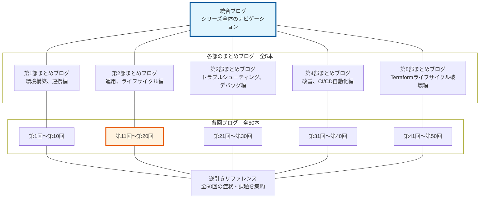

<style> table th, table td { word-break: normal; } table td:first-child { white-space: nowrap; } </style>

> **🗺️ 初めての方・シリーズの全体像を知りたい方はこちら**
> 
> シリーズ全体については、以下のまとめブログで整理しています。
> 
> → **[「AnsibleとTerraformの連携が壊れる理由はライフサイクルにあった」第2部まとめブログ： TerraformとAnsibleの運用で直面する構成ズレと状態管理の問題](https://qiita.com/juehara-crypto/items/c3e95e3bec11e07bbe75)**

---

> **🔍 今起きている症状・課題から、読むべき回を探したい方はこちら**
>
> 全50回で扱った症状・課題を、部をまたいで1か所に集めた逆引きリファレンスがあります。
> 症状・課題の一覧から原因の見当をつけ、該当する回のセクションまでたどれます。
>
> → **[「AnsibleとTerraformの連携が壊れる理由はライフサイクルにあった」逆引きリファレンス：全50回の症状・課題を5つの図から引く](https://qiita.com/juehara-crypto/items/bd2832993ef887e8022a)**

---

**※本記事の位置とシリーズ全体の関係を先に確認します。**

---

## 📍 本記事の位置



本シリーズは、**[統合ブログ](https://qiita.com/juehara-crypto/items/5bd6720b7aaed13757f8)**、第1〜5部のまとめブログ（全5本）、第1〜50回の各回ブログ（全50本）の3階層で構成されています。**現在はこの図の下段、第2部「第11回〜第20回」のうちの第20回になります。** 統合ブログとまとめブログは、シリーズを上から順に読み進めるための入口です。

また、この3階層とは別に、**[逆引きリファレンス](https://qiita.com/juehara-crypto/items/bd2832993ef887e8022a)** があります。第1〜50回の各回ブログで扱った症状・課題を、部をまたいで1か所に集め、今起きている症状や解決したい課題から、該当する回へ直接たどり着けるようにしたものです。

---

## 📋 目次

1. [はじめに](#1-はじめに)
2. [第11〜19回をミュータブル/イミュータブルの軸で再整理する](#2-第1119回をミュータブルイミュータブルの軸で再整理する)
3. [ミュータブル運用の特性](#3-ミュータブル運用の特性)
4. [イミュータブル運用の特性](#4-イミュータブル運用の特性)
5. [TerraformとAnsibleの役割の変化](#5-terraformとansibleの役割の変化)
6. [折衷案：リソースの性質による使い分け](#6-折衷案リソースの性質による使い分け)
7. [まとめ](#7-まとめ)
8. [次回予告](#8-次回予告)
9. [連載一覧：「AnsibleとTerraformの連携が壊れる理由はライフサイクルにあった」](#9-連載一覧ansibleとterraformの連携が壊れる理由はライフサイクルにあった)

---

## 1. はじめに

**[第11回](https://juehara-crypto.github.io/blog/infra/ansible/ansible-terraform/ansible-terraform-part2/ansible-terraform-part2-11/)** から **[第19回](https://juehara-crypto.github.io/blog/infra/ansible/ansible-terraform/ansible-terraform-part2/ansible-terraform-part2-19/)** にかけて、構築後の継続運用で直面するトラブルを一つずつ扱ってきました。手動変更によるドリフト、初期化処理の変更による再生成とAnsible設定の消失、リソースの強制再生成、Playbookの冪等性、tfstateの整合性、パッケージアップデートによる非互換、IPアドレスの変動、機密情報の役割分担、OSのメジャーバージョンアップ。これらは個別に見ると独立した問題ですが、今回はこれらを振り返るのではなく、「なぜこの問題が起きるのか」という共通の軸で整理し直します。

その軸となるのが、「リソースを直し続けて使うか、使い捨てて入れ替えるか」という運用思想の違いです。前者を一般にミュータブル運用、後者をイミュータブル運用と呼びます。**[第11回](https://juehara-crypto.github.io/blog/infra/ansible/ansible-terraform/ansible-terraform-part2/ansible-terraform-part2-11/)** から **[第19回](https://juehara-crypto.github.io/blog/infra/ansible/ansible-terraform/ansible-terraform-part2/ansible-terraform-part2-19/)** で扱ってきた事象の多くは、この2つの運用思想のどちらに近い性質を持つかによって整理し直すことができます。

**[第19回](https://juehara-crypto.github.io/blog/infra/ansible/ansible-terraform/ansible-terraform-part2/ansible-terraform-part2-19/)** では、OSのメジャーバージョンアップというTerraform側の能動的な操作が、Ansible側のPlaybookにどう影響するかを実機で確認しました。今回はこの個別の事象から離れ、第2部（第11〜19回）全体を俯瞰する回になります。

この回で扱う問いは、「両ツールを使う以上、ミュータブル運用とイミュータブル運用のどちらに寄せるべきか、あるいはどう折衷するか」です。

次のセクションでは、まず第11〜19回の事象を、ミュータブル/イミュータブルの軸で再整理します。

---

[↑ 目次に戻る](#-目次)

---

## 2. 第11〜19回をミュータブル/イミュータブルの軸で再整理する

第2部で扱った各回を、運用思想の軸で分類します。

|回|事象|運用思想との関係|
|---|---|---|
|**[第11回](https://juehara-crypto.github.io/blog/infra/ansible/ansible-terraform/ansible-terraform-part2/ansible-terraform-part2-11/)**|手動変更ドリフトの検知|ミュータブル型（手動変更という事象自体が、リソースを直し続けて使う運用でこそ起きるため）|
|**[第12回](https://juehara-crypto.github.io/blog/infra/ansible/ansible-terraform/ansible-terraform-part2/ansible-terraform-part2-12/)**|初期化処理変更によるリソース再生成・設定消失|イミュータブル型（作り直しが起点）|
|**[第13回](https://juehara-crypto.github.io/blog/infra/ansible/ansible-terraform/ansible-terraform-part2/ansible-terraform-part2-13/)**|リソース定義変更による強制再生成|イミュータブル型（作り直しが起点）|
|**[第14回](https://juehara-crypto.github.io/blog/infra/ansible/ansible-terraform/ansible-terraform-part2/ansible-terraform-part2-14/)**|Playbook複数回実行時の冪等性|両方に関わる（どちらの運用でも再実行は発生する）|
|**[第15回](https://juehara-crypto.github.io/blog/infra/ansible/ansible-terraform/ansible-terraform-part2/ansible-terraform-part2-15/)**|tfstateの整合性維持|両方に関わる（チーム運用での競合はどちらの運用思想でも発生しうる）|
|**[第16回](https://juehara-crypto.github.io/blog/infra/ansible/ansible-terraform/ansible-terraform-part2/ansible-terraform-part2-16/)**|パッケージアップデート非互換|ミュータブル型（同じリソースを使い続けるからこそ発生する）|
|**[第17回](https://juehara-crypto.github.io/blog/infra/ansible/ansible-terraform/ansible-terraform-part2/ansible-terraform-part2-17/)**|IPアドレス変動と静的インベントリのUNREACHABLE|イミュータブル型（再生成が起点）|
|**[第18回](https://juehara-crypto.github.io/blog/infra/ansible/ansible-terraform/ansible-terraform-part2/ansible-terraform-part2-18/)**|`sensitive`でもtfstateに平文で残る機密情報の扱い|両方に関わる（運用思想に関わらず必要な設計）|
|**[第19回](https://juehara-crypto.github.io/blog/infra/ansible/ansible-terraform/ansible-terraform-part2/ansible-terraform-part2-19/)**|OSメジャーバージョンアップ|イミュータブル型（ベースイメージ切り替えという、作り直しを起点にした操作であるため）|

この表を見ると、第2部全体がミュータブル運用とイミュータブル運用のどちらかに偏っていたわけではないことが分かります。**[第11回](https://juehara-crypto.github.io/blog/infra/ansible/ansible-terraform/ansible-terraform-part2/ansible-terraform-part2-11/)**、**[第16回](https://juehara-crypto.github.io/blog/infra/ansible/ansible-terraform/ansible-terraform-part2/ansible-terraform-part2-16/)** はリソースを直し続けて使うことを前提にした問題であり、**[第12回](https://juehara-crypto.github.io/blog/infra/ansible/ansible-terraform/ansible-terraform-part2/ansible-terraform-part2-12/)**、**[第13回](https://juehara-crypto.github.io/blog/infra/ansible/ansible-terraform/ansible-terraform-part2/ansible-terraform-part2-13/)**、**[第17回](https://juehara-crypto.github.io/blog/infra/ansible/ansible-terraform/ansible-terraform-part2/ansible-terraform-part2-17/)**、**[第19回](https://juehara-crypto.github.io/blog/infra/ansible/ansible-terraform/ansible-terraform-part2/ansible-terraform-part2-19/)** はリソースを作り直すことそのものが起点になった問題でした。そして **[第14回](https://juehara-crypto.github.io/blog/infra/ansible/ansible-terraform/ansible-terraform-part2/ansible-terraform-part2-14/)**、**[第15回](https://juehara-crypto.github.io/blog/infra/ansible/ansible-terraform/ansible-terraform-part2/ansible-terraform-part2-15/)**、**[第18回](https://juehara-crypto.github.io/blog/infra/ansible/ansible-terraform/ansible-terraform-part2/ansible-terraform-part2-18/)** は、どちらの運用思想を採用していても向き合う必要がある問題です。

第2部が扱ってきたトラブルの背後には、こうした2つの運用思想が混在する状態が前提としてあり、その混在自体が問題の起きやすさに関わっていたことが見えてきます。次のセクションでは、まずミュータブル運用そのものの特性を整理します。

---

[↑ 目次に戻る](#-目次)

---

## 3. ミュータブル運用の特性

ミュータブル運用の特性を整理します。

リソースを直し続けて使う運用には、次のような利点があります。

* リソース内部のデータや状態がそのまま維持される（再生成によるデータ消失リスクがない）
* 物理的、仮想的なリソースに制約がある環境と相性がよい

一方で、次のような欠点も抱えます。

* **[第11回](https://juehara-crypto.github.io/blog/infra/ansible/ansible-terraform/ansible-terraform-part2/ansible-terraform-part2-11/)** で扱った手動変更ドリフトが蓄積しやすい
* **[第14回](https://juehara-crypto.github.io/blog/infra/ansible/ansible-terraform/ansible-terraform-part2/ansible-terraform-part2-14/)** で扱った冪等性の管理負担が、運用の長期化とともに増える
* **[第16回](https://juehara-crypto.github.io/blog/infra/ansible/ansible-terraform/ansible-terraform-part2/ansible-terraform-part2-16/)** で扱ったパッケージアップデートによる非互換リスクを抱え続ける

これらの欠点に共通しているのは、同じリソースを使い続けるからこそ、時間の経過とともに状態がずれていく、あるいは前提が古くなっていくという構造です。ミュータブル運用は、リソースを作り直すコスト（確保や再構築の手間）が高い環境では、自然とこの運用思想に寄りやすくなります。

次のセクションでは、対照的な性質を持つイミュータブル運用の特性を整理します。

---

[↑ 目次に戻る](#-目次)

---

## 4. イミュータブル運用の特性

イミュータブル運用の特性を整理します。

リソースを使い捨てて入れ替える運用には、次のような利点があります。

* ドリフトが蓄積する前にリソースごと入れ替えるため、ドリフト問題を根本的に回避できる
* 常にクリーンな状態からスタートするため、動かなくなった原因の切り分けが単純になる

一方で、次のような欠点も抱えます。

* **[第12回](https://juehara-crypto.github.io/blog/infra/ansible/ansible-terraform/ansible-terraform-part2/ansible-terraform-part2-12/)**、**[第13回](https://juehara-crypto.github.io/blog/infra/ansible/ansible-terraform/ansible-terraform-part2/ansible-terraform-part2-13/)** で扱ったリソース再生成によるOS内部データの消失リスクを常に抱える
* **[第17回](https://juehara-crypto.github.io/blog/infra/ansible/ansible-terraform/ansible-terraform-part2/ansible-terraform-part2-17/)** で扱ったIPアドレス変動への追従が常に必要になる
* リソースの作り直しに伴うコスト（時間、リソース利用料）が発生する

これらの欠点に共通しているのは、リソースを入れ替えるたびに、内部の状態や接続情報がゼロから作り直される、あるいは変動しうるという構造です。ミュータブル運用が「同じリソースを使い続けるからこそ生じる問題」を抱えていたのに対し、イミュータブル運用は「作り直すからこそ生じる問題」を抱えているという、対照的な関係にあります。リソースの作り直しが容易な環境では、この運用思想に寄せやすくなります。

次のセクションでは、この2つの運用思想によって、TerraformとAnsibleそれぞれの役割の重心がどう変わるかを整理します。

---

[↑ 目次に戻る](#-目次)

---

## 5. TerraformとAnsibleの役割の変化

運用思想によって、TerraformとAnsibleの役割分担の重心がどう変わるかを整理します。

```plaintext
ミュータブル運用の場合
　Terraform：作成後の変更頻度は低い（継続的な`plan`によるドリフト検知、`apply`もあり得る）
　Ansible：継続的な構成管理、ドリフト是正が主役

イミュータブル運用の場合
　Terraform：リソースの作成、破棄を頻繁に担う主役
　Ansible：作り直すたびの初期設定投入が役割（継続的なドリフト是正の比重は下がる）
```

ミュータブル運用では、リソースそのものは初回構築後ほとんど変わらず、Ansibleが継続的にOS内部の状態を整え続ける役割を担います。セクション3で見た欠点、ドリフトの蓄積や冪等性の管理負担は、この役割の重さがそのまま表れたものです。

一方、イミュータブル運用では、リソースの作成と破棄そのものが運用の中心になり、Terraformが主役の位置に移ります。Ansibleは、作り直されたリソースに対して初期設定を投入する役割に限定され、ミュータブル運用のように長期間にわたってドリフトを是正し続けるという役割は後退します。

この構造は、**[第1回](https://juehara-crypto.github.io/blog/infra/ansible/ansible-terraform/ansible-terraform-part1/ansible-terraform-part1-01/)** で整理した「リソース生成はTerraform、構成管理はAnsible」という基本的な役割分担そのものを覆すものではありません。両ツールが担うレイヤーの境界は変わらないまま、運用フェーズに入ってどちらの運用思想を採用するかによって、どちらのツールがより中心的な役割を果たすかという重心だけが変わる、という関係です。

次のセクションでは、この2つの運用思想を踏まえたうえで、この回の結論となる折衷案を整理します。

---

[↑ 目次に戻る](#-目次)

---

## 6. 折衷案：リソースの性質による使い分け

この回の結論となる折衷案を整理します。

ここまで見てきたミュータブル運用とイミュータブル運用は、どちらも一長一短であり、片方が一方的に優れているという関係ではありません。すべてのリソースを一律にイミュータブルへ寄せる必要はなく、リソースの性質によって使い分けるという考え方が現実的な着地点になります。

|リソースの性質|向いている運用|理由|
|---|---|---|
|ステートフルなリソース（DB、ストレージ等）|ミュータブル寄り|データの消失リスクが致命的になるため|
|ステートレスなリソース（アプリケーションサーバー等）|イミュータブル寄り|データを保持しないため、使い捨てによる影響が小さい|

ステートフルなリソースは、セクション4で見たイミュータブル運用の欠点、リソース再生成に伴うデータ消失リスクをそのまま引き受けることになるため、直し続けて使うミュータブル運用の方が向いています。一方、ステートレスなリソースはデータを保持しないため、作り直しても失うものが少なく、セクション4で見たイミュータブル運用の利点、ドリフトの根本回避や原因切り分けの単純化を素直に活かせます。

この使い分けにおいて、ステートフルなリソースを保持しながら安全に再構築する具体的な設計パターン（Volumeの分離など）は、この回では扱いません。この領域は第5部、**[第47回](https://juehara-crypto.github.io/blog/infra/ansible/ansible-terraform/ansible-terraform-part5/ansible-terraform-part5-47/)** で個別に扱う内容になります。今回押さえておきたいのは、「性質によって使い分ける」という考え方そのものです。

次のセクションでは、この回で整理した内容を改めてまとめます。

---

[↑ 目次に戻る](#-目次)

---

## 7. まとめ

この回で整理した内容を確認します。

* **[第11回](https://juehara-crypto.github.io/blog/infra/ansible/ansible-terraform/ansible-terraform-part2/ansible-terraform-part2-11/)** から **[第19回](https://juehara-crypto.github.io/blog/infra/ansible/ansible-terraform/ansible-terraform-part2/ansible-terraform-part2-19/)** で扱った問題は、「リソースを直し続けて使うか、使い捨てて入れ替えるか」というミュータブル運用とイミュータブル運用の軸で整理し直せる。**[第11回](https://juehara-crypto.github.io/blog/infra/ansible/ansible-terraform/ansible-terraform-part2/ansible-terraform-part2-11/)**、**[第16回](https://juehara-crypto.github.io/blog/infra/ansible/ansible-terraform/ansible-terraform-part2/ansible-terraform-part2-16/)** はミュータブル型、**[第12回](https://juehara-crypto.github.io/blog/infra/ansible/ansible-terraform/ansible-terraform-part2/ansible-terraform-part2-12/)**、**[第13回](https://juehara-crypto.github.io/blog/infra/ansible/ansible-terraform/ansible-terraform-part2/ansible-terraform-part2-13/)**、**[第17回](https://juehara-crypto.github.io/blog/infra/ansible/ansible-terraform/ansible-terraform-part2/ansible-terraform-part2-17/)**、**[第19回](https://juehara-crypto.github.io/blog/infra/ansible/ansible-terraform/ansible-terraform-part2/ansible-terraform-part2-19/)** はイミュータブル型、**[第14回](https://juehara-crypto.github.io/blog/infra/ansible/ansible-terraform/ansible-terraform-part2/ansible-terraform-part2-14/)**、**[第15回](https://juehara-crypto.github.io/blog/infra/ansible/ansible-terraform/ansible-terraform-part2/ansible-terraform-part2-15/)**、**[第18回](https://juehara-crypto.github.io/blog/infra/ansible/ansible-terraform/ansible-terraform-part2/ansible-terraform-part2-18/)** はどちらの運用でも向き合う必要がある問題として位置づけられる
* ミュータブル運用は、リソース内部のデータや状態がそのまま維持されるという利点を持つ一方、ドリフトの蓄積や冪等性の管理負担、パッケージアップデートによる非互換リスクを抱え続けるという欠点がある
* イミュータブル運用は、ドリフトを根本的に回避でき原因の切り分けが単純になるという利点を持つ一方、リソース再生成によるデータ消失リスクとIPアドレス変動への追従コストを抱えるという欠点がある
* 運用思想によって、TerraformとAnsibleのどちらが主役になるかの重心が変わる。ミュータブル運用ではAnsibleが継続的な構成管理を担い、イミュータブル運用ではTerraformがリソースの作成、破棄を頻繁に担う
* すべてのリソースを一律にイミュータブルへ寄せる必要はなく、ステートフルなリソースはミュータブル寄り、ステートレスなリソースはイミュータブル寄りという、リソースの性質による使い分けが現実的な折衷案になる

---

[↑ 目次に戻る](#-目次)

---

## 8. 次回予告

**[第19回](https://juehara-crypto.github.io/blog/infra/ansible/ansible-terraform/ansible-terraform-part2/ansible-terraform-part2-19/)** では、Terraform側でベースイメージを新しいOS世代に切り替える操作が、Ansibleの実行対象OSを一気に変えるという構造を確認しました。

今回は視点を切り替え、**[第11回](https://juehara-crypto.github.io/blog/infra/ansible/ansible-terraform/ansible-terraform-part2/ansible-terraform-part2-11/)** から **[第19回](https://juehara-crypto.github.io/blog/infra/ansible/ansible-terraform/ansible-terraform-part2/ansible-terraform-part2-19/)** で扱ってきた個別の事象を、ミュータブル運用とイミュータブル運用という共通の軸で整理し直しました。両運用思想それぞれの利点と欠点、TerraformとAnsibleの役割分担の重心の変化を踏まえ、リソースの性質による使い分けという折衷案を整理し、第2部（運用、ライフサイクル編）を締めくくります。

**[第21回](https://juehara-crypto.github.io/blog/infra/ansible/ansible-terraform/ansible-terraform-part3/ansible-terraform-part3-21/)** からは第3部（トラブルシューティング、デバッグ編）に入ります。視点は「設計、運用」から「障害発生時の原因特定」に移り、Terraformの`local-exec`経由で実行されたAnsibleのエラーログから、原因がTerraform側なのかAnsible側なのかを切り分ける手法を扱います。

**[次回：第21回：統合実行時におけるネストされたエラーログの解析手法](https://juehara-crypto.github.io/blog/infra/ansible/ansible-terraform/ansible-terraform-part3/ansible-terraform-part3-21/)**

---

📑 連載の移動　**[前の記事：【Ansible×Terraform編】第19回](https://juehara-crypto.github.io/blog/infra/ansible/ansible-terraform/ansible-terraform-part2/ansible-terraform-part2-19/)　｜　[次の記事：【Ansible×Terraform編】第21回](https://juehara-crypto.github.io/blog/infra/ansible/ansible-terraform/ansible-terraform-part3/ansible-terraform-part3-21/)**

---

> **🗺️ 初めての方・シリーズの全体像を知りたい方はこちら**
> 
> シリーズ全体については、以下のまとめブログで整理しています。
> 
> → **[「AnsibleとTerraformの連携が壊れる理由はライフサイクルにあった」第2部まとめブログ： TerraformとAnsibleの運用で直面する構成ズレと状態管理の問題](https://qiita.com/juehara-crypto/items/c3e95e3bec11e07bbe75)**

---

> **🔍 今起きている症状・課題から、読むべき回を探したい方はこちら**
>
> 全50回で扱った症状・課題を、部をまたいで1か所に集めた逆引きリファレンスがあります。
> 症状・課題の一覧から原因の見当をつけ、該当する回のセクションまでたどれます。
>
> → **[「AnsibleとTerraformの連携が壊れる理由はライフサイクルにあった」逆引きリファレンス：全50回の症状・課題を5つの図から引く](https://qiita.com/juehara-crypto/items/bd2832993ef887e8022a)**

---

[↑ 目次に戻る](#-目次)

---

## 9. 連載一覧：「AnsibleとTerraformの連携が壊れる理由はライフサイクルにあった」

### 第2部：運用、ライフサイクル編

|回数|テーマ、記事タイトル|概要|
|---|---|---|
|**[第11回](https://juehara-crypto.github.io/blog/infra/ansible/ansible-terraform/ansible-terraform-part2/ansible-terraform-part2-11/)**|Terraformのplanが、手動やAnsibleによるOS内部の変更を検知できない理由―tfstateの管理範囲と、--check --diffによる補完|構築後に手動やAnsibleで変更したOS内部の状態は、tfstateの管理範囲の外にあるため、Terraformの`plan`では検知できない。Ansibleの`--check --diff`による補完と、インフラ層、OS層を二軸で確認、同期する手順を整理する。ドリフトシリーズとの接続を示す。|
|**[第12回](https://juehara-crypto.github.io/blog/infra/ansible/ansible-terraform/ansible-terraform-part2/ansible-terraform-part2-12/)**|初期化スクリプト・コンテナ起動定義を変更してterraform applyを再実行すると、コンテナが作り直されてAnsibleの設定が消える理由―uploadブロックのforces replacementと、初期化処理とAnsibleの役割分離|初期化スクリプトやコンテナ起動定義の変更で`forces replacement`が発生し、リソースが破棄、再生成されて、Ansibleが設定済みのOS内部状態が消える課題。初期化処理とAnsibleの役割分離で消失の影響を小さくする設計を整理する。|
|**[第13回](https://juehara-crypto.github.io/blog/infra/ansible/ansible-terraform/ansible-terraform-part2/ansible-terraform-part2-13/)**|HCLの1行の変更でコンテナが破棄、再生成され、Ansibleの設定が消える理由―更新と再生成の分かれ目と、terraform planの「-/+」「forces replacement」による事前判定|HCLの1行の変更でも、属性によっては「更新」ではなく「破棄、再生成」となり、Ansibleが投入した設定が消える。`terraform plan`の`~`と`-/+`、`forces replacement`の注記から、`apply`前に再生成を見分ける方法を整理する。|
|**[第14回](https://juehara-crypto.github.io/blog/infra/ansible/ansible-terraform/ansible-terraform-part2/ansible-terraform-part2-14/)**|local-execで再実行されたAnsibleが失敗し、terraform applyが止まる理由―冪等でないcommand（mkdir）と、--check --diffでは検出できない限界|`local-exec`経由でAnsibleが複数回実行される構成で、冪等でないPlaybookが2回目の実行で失敗し、`terraform apply`自体の失敗につながる問題。専用モジュールへの置き換えと、`--check --diff`では検出できない限界を整理する。冪等性シリーズ、レガシーPlaybook引き継ぎの知識を実践に適用する回として位置づける。|
|**[第15回](https://juehara-crypto.github.io/blog/infra/ansible/ansible-terraform/ansible-terraform-part2/ansible-terraform-part2-15/)**|複数人が別々のディレクトリでterraform applyしたtfstateを上書きすると記録が消え、出力名の変更だけでAnsibleのスクリプトも止まる理由―state lockingの守備範囲と、中間ファイルによる分離|複数人が別々のディレクトリで扱ったtfstateを上書きすると記録が消える問題と、Ansible担当がtfstateを直接参照すると、出力名の変更だけでスクリプトが止まる問題。state lockingの守備範囲と、中間ファイルによる分離、apply実行権限の設計を整理する。|
|**[第16回](https://juehara-crypto.github.io/blog/infra/ansible/ansible-terraform/ansible-terraform-part2/ansible-terraform-part2-16/)**|apt update／apt upgradeでパッケージが更新されると、バージョンを前提にしたAnsible Playbookが失敗する理由―Terraformのイメージ固定の範囲外と、aptモジュールでのバージョン指定|運用中に`apt update`、`apt upgrade`でパッケージが更新されると、バージョンを前提にしたAnsible Playbookが失敗する問題。Terraformのイメージ固定が及ばない範囲と、`apt`モジュールでのバージョン指定による制御を整理する。|
|**[第17回](https://juehara-crypto.github.io/blog/infra/ansible/ansible-terraform/ansible-terraform-part2/ansible-terraform-part2-17/)**|リソースの再生成でIPアドレスが変わると、静的インベントリのままではAnsibleがUNREACHABLEになる理由―動的インベントリで追従できる範囲と、DNS・hostsなど追従できない参照|リソースの再生成でIPアドレスが変わると、書き換えていない静的インベントリではAnsibleが`UNREACHABLE`になる問題。動的インベントリで追従できる範囲と、DNSや`/etc/hosts`など追従できない参照を整理する。|
|**[第18回](https://juehara-crypto.github.io/blog/infra/ansible/ansible-terraform/ansible-terraform-part2/ansible-terraform-part2-18/)**|sensitive = trueを指定してもtfstateにパスワードが平文で残る理由―Ansible Vaultとの責務分担と、Vaultの誤用パターン|`sensitive = true`を指定しても、`output`の値がtfstateに平文で残る問題。TerraformとAnsible Vaultの責務分担と、Vaultの誤用パターンと回避策を整理する。|
|**[第19回](https://juehara-crypto.github.io/blog/infra/ansible/ansible-terraform/ansible-terraform-part2/ansible-terraform-part2-19/)**|ベースイメージをUbuntu 22.04から24.04に切り替えると、ansible_python_interpreterでPython 3.10を固定したPlaybookがnot foundで失敗する理由―自動検出との違いと、/etc/apt/sources.listの形式変更|ベースイメージをUbuntu 22.04から24.04に切り替えると、`ansible_python_interpreter`をパスで固定したPlaybookが`not found`で失敗する問題。自動検出との違いと、`/etc/apt/sources.list`の形式変更、標準モジュールの抽象化の限界を整理する。|
|**[第20回](https://juehara-crypto.github.io/blog/infra/ansible/ansible-terraform/ansible-terraform-part2/ansible-terraform-part2-20/)**|運用編まとめ：第11〜19回のトラブルは、リソースを直し続ける運用と作り直す運用のどちらで起きるか―ステートフルならミュータブル、ステートレスならイミュータブルという使い分け|第11〜19回のトラブルを、リソースを直し続けるミュータブル運用と、作り直すイミュータブル運用の軸で整理する。ステートフルならミュータブル、ステートレスならイミュータブルという使い分けを着地点として示す。|

---

[↑ 目次に戻る](#-目次)

---